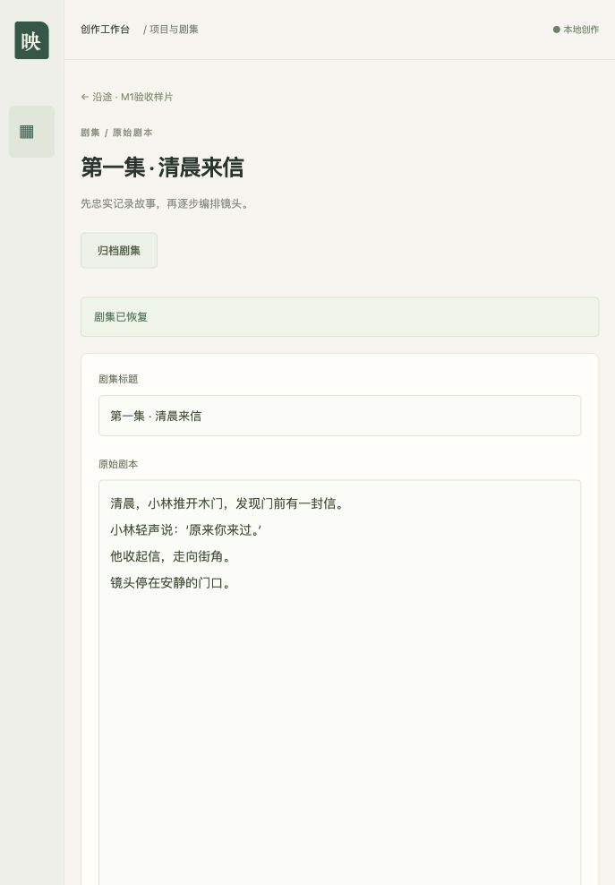

# M1 项目与剧集实施记录

日期：2026-10-25。范围：已确认计划的任务1、2；M3及后续模块不在本次实施范围。

## 当前交付

- FastAPI本机API、SQLite九类业务模型、独立短Session、真实外键、WAL及5000ms锁等待。
- 完整初始Alembic迁移，支持新库创建、再次启动及降级再升级；不读取旧DrawThings数据。
- 项目创建、读取、风格和角色编辑；剧集创建、读取、剧本编辑；项目与剧集归档/恢复。
- 乐观版本检查、归档只读、活跃任务禁止归档、本机会话令牌和同源写保护。
- Next.js页面、Tailwind响应式布局、Zustand实体作用域草稿、OpenAPI生成的严格TS类型。
- 409冲突保留草稿和旧基线；明确读取并核对最新内容后才允许用户选择新基线再保存。
- 有界检查入口，超时停止整个测试子进程组；不做内存检测、不连接模型、不引入云服务。

## 测试证据

后端从缺少app模块和运行脚本的失败测试开始；基础15项通过后，针对默认文档CDN入口和错误契约不一致各先补失败测试，再修正并通过。当前后端17项通过。

前端先观察缺少UI模块导致的失败，再实现表单。基础5项通过；补充“冲突后人工核对再保存”的失败测试后实现恢复入口，当前6项通过。

静态检查：Ruff和格式检查通过；TypeScript严格检查、ESLint检查通过。Next.js 16.4.3生产构建通过。构建所需临时本机端口由验收环境放行，未更换构建器规避问题。

使用FastAPI实际HTTP服务和Next.js生产页面完成浏览器验收：

1. 从空验收库创建“沿途 · M1验收样片”。
2. 保存自制风格及“小林”角色描述。
3. 创建“第一集 · 清晨来信”，保存原创45字剧本。
4. 打开剧集并刷新，确认原始剧本持久存在。
5. 修改为56字剧本，保存后出现成功提示。
6. 归档后标题、剧本和保存按钮只读；恢复后重新可编辑。

验收数据位于Git忽略的`.superpowers/`隔离目录，不是正式`data/`，也没有旧项目数据。截图为本平台及自制文本：

## 实施决定

- 原生工作区可创建但本轮沙箱拒绝写入，故在已授权项目目录的新分支开发；最终提交需同步到附属工作区，避免下轮读到旧代码。
- 技能辅助脚本只识别英文Task标题，已按原中文任务内容提取本地简报，不修改全局技能。
- 明确EXPORT需要episode_id、仅shot_id为空，修正设计中的歧义；不是旧库迁移或协议兼容改动。
- 当前FastAPI/Starlette官方TestClient使用httpx2，测试依赖按其发行元数据锁定；未实现模型HTTP客户端。
- Next.js 16.4.3子插件的peer约束尚不接收ESLint10，使用匹配的ESLint9.39.5以保证依赖图有效；该开发工具已收到上游停止维护提示，后续工具链升级需连同插件审查。此项不影响运行时。

## 审查与用户验收

独立代码审查安排在全部任务实现及回归之后；其结论和必要修复在交付前补充。本模块在用户验收前不计入“已验收”任务，下一模块为M3，不能自动启动。
