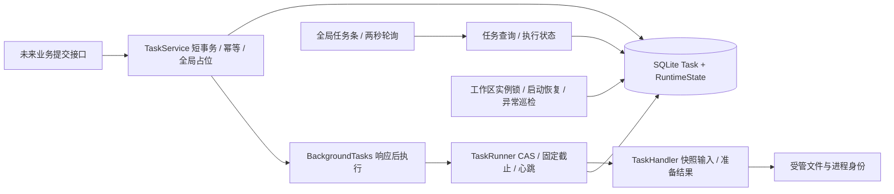
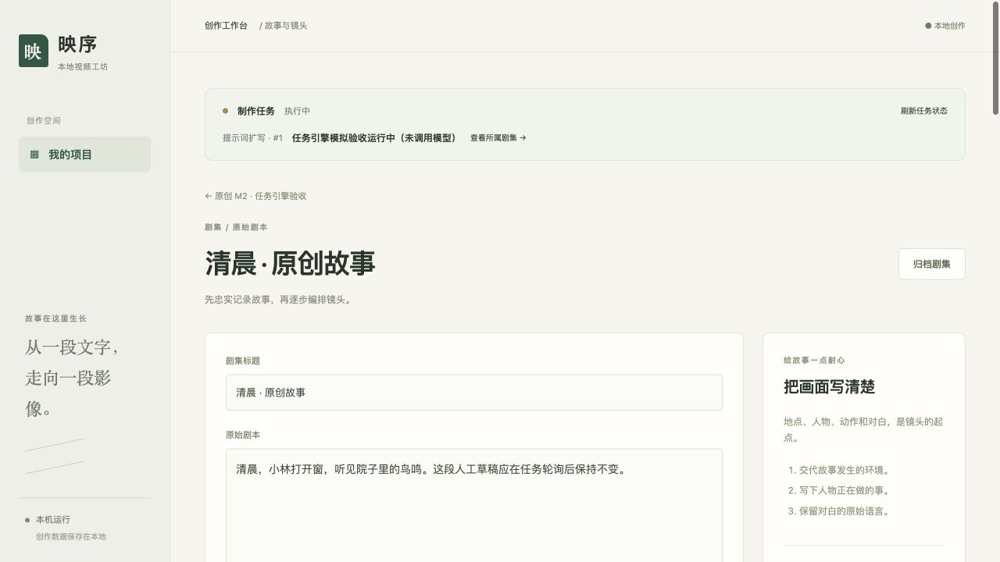
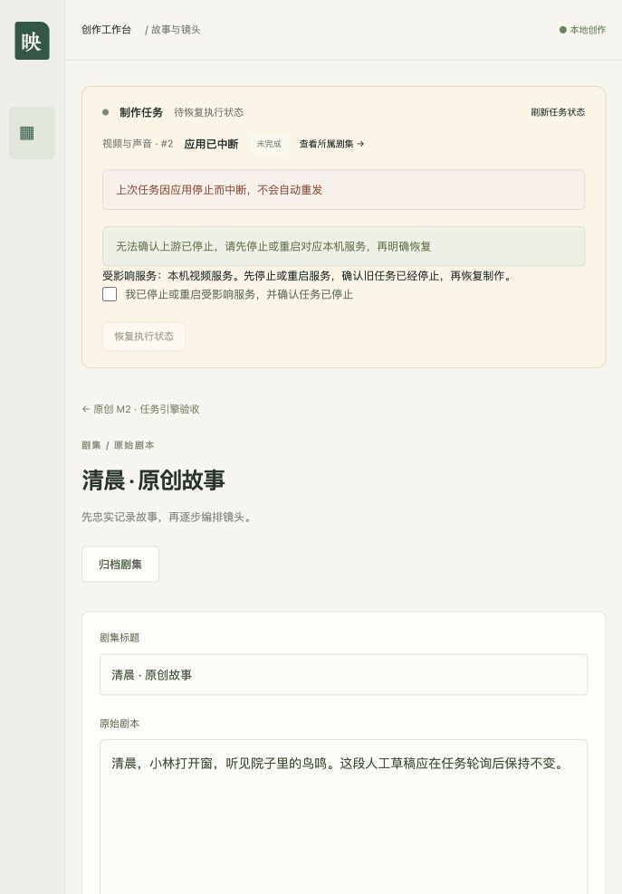
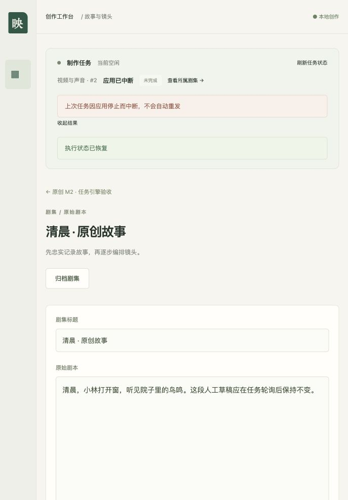

# M2 单任务引擎与恢复

2026-10-25，用户已验收M3并授权M2，本轮仅实施任务3、4、5。新增任务服务/Runner/恢复服务、任务查询与runtime接口、实例锁和进程身份保护、任务条与轮询组件及对应测试；扩充任务响应契约，修改main生命周期、数据库错误映射、OpenAPI和中文进度。不修改已有业务表，不开放通用假任务入口，不接入模型生成。

可行性复核：复用M1的活动条件唯一索引与RuntimeState、M3的不可变文件服务；提交校验与结果发布都用独立短事务。没有模型处理器时生产仅提供查询与恢复，测试通过注入处理器及测试专用HTTP端点验证202响应先于完成。恢复在任何孤立文件扫描之前取得操作系统锁，不能由轮询或连接测试推断上游空闲。

当前状态：开发、独立审查修正、回归和演示完成，等待用户验收。M2尚未计入已验收。

交付分支：`codex/m2-task-engine`。草稿[PR #4](https://github.com/yyl1212/video_maker/pull/4)以已验收M3分支为基线，依赖[PR #3](https://github.com/yyl1212/video_maker/pull/3)，不自动合并。

## 已验证能力

- 不同独立数据库连接竞争全局槽位，只接收一个PENDING；跨类型共享槽位，忙时429并返回active_job_id；数据库忙为503/DATABASE_BUSY。
- 同键同体返回已有任务，包括已完成任务；同键不同体409；后台注册失败标记FAILED并释放尚未开始的任务。
- 真实TCP测试证明202和job_id在受控任务完成前可被客户端读取；不使用会等待BackgroundTasks完成的TestClient证明这一点。
- CAS启动、独立Session、每5秒心跳、统一TaskOutcome发布；媒体Asset、Task DONE及运行态释放同事务，失败回滚不留成功资产，不自动修改Shot选择。
- 工作区OS实例锁在迁移和孤立文件扫描之前取得；重启中断任务失败且不重放；远程执行已发出但未确认结束时NEEDS_RESET。
- 30秒未启动PENDING巡检失败；RUNNING心跳异常只告警，不释放活任务；总截止为文本480、图片570、视频540、导出540秒，进度不延长截止。测试注入短预算，无数分钟等待。
- 子进程经暂停许可启动器，先持久化启动时间、PID/进程组、任务目录及随机标记，再放行真正程序；清理核验身份，旧PID身份不匹配不盲杀。真实FFmpeg运行及超时终止通过。
- 数据库终态故障保持封闭，只重试写入失败元数据，不重试制作。仍在执行或拒绝取消的任务不能被人工恢复提前解锁。
- 全局任务条每2秒读取，隐藏页5秒，详情终态停止；切换作用域和卸载丢弃晚响应；断网仅查询重连，不POST；本页记忆只保存job_id，服务端持有执行锁。
- 恢复需用户明确已停止服务并固定运行态版本；轮询变化不能自动升级确认。工作台草稿不受任务轮询影响。

完整回归：后端79项、前端32项通过；Ruff、TypeScript严格检查、ESLint、Prettier、Next生产构建通过。测试命令均受540秒限制，完整后端约6秒。

## 实施决策

1. 绑定隔离工作树不在可写根中，沿用已验证降级路径：原仓库独立codex/m2-task-engine分支，显式目录，收尾同步工作树。风险是漏写目录会写入失败。
2. 中文任务段手工核对brief和BASE，不修改只解析英文标题的全局技能脚本。风险是依赖人工核对清单。
3. 生产处理器注册表保持空，模拟处理器和提交端点只在独立测试应用中注入。代价是本轮尚不能提交模型生成，后续M5等模块注册业务接口。
4. 使用暂停许可的本地Python启动器消除启动进程与登记身份之间的崩溃窗口；代价是一次短进程启动，不引入制作队列或云服务。
5. psutil只读取进程启动身份、目录和状态，不读取内存。受限沙箱不能枚举进程时保持NEEDS_RESET；正常本机用户执行与测试放行后验证身份和清理通过。
6. 无法证明Outcome文件归属时不即时移动；未登记失败输出留给下次独占启动的巡检，核对全部Asset主文件与缩略图后隔离。代价是可能暂存至下次启动，接口不会将其展示为资产。
7. 关闭先停止新任务，等执行协程及真实在途I/O退出后才释放锁。拒绝退出时保持工作区占用，必要时退出整个进程；不能为了快速关闭提前让新实例接管。

接口兼容性：扩充尚未开放生成入口的TaskRead与BackendError，并为429增加可空active_job_id；既有M1/M3业务接口和表结构不变。新任务条与OpenAPI同批交付。

官方依据：[FastAPI后台任务](https://fastapi.tiangolo.com/tutorial/background-tasks/)、[psutil进程身份接口](https://psutil.io/api/)。

## 独立审查与修正

审查范围76cd2bb..edf409b，独立复跑后端75项及任务条7项，发现2项Important，未发现Critical或Minor。一次修正全部完成：

- 旧处理协程未退出时生命周期可能提前交出锁。补充跨生命周期协程与在途claim线程两类失败测试；关闭跟踪真实I/O、停止接收并等待所有执行退出，测试RED→GREEN。
- 发布失败清理可能误隔离已登记主文件或共享缩略图。补充两类失败回归；不信任Outcome路径所有权，保留原文件，由独占启动扫描安全隔离未登记文件，测试RED→GREEN。

审查暂不评判的范围已明确：真实模型协议（M4/M5/M6）；完整草稿采纳与生成过期联调（既有M3及后续处理器）；成片音画对齐（M6/M7）；PreparedAsset的解码/尺寸/音轨语义由各处理器验证。本轮负责引擎事务、路径/哈希、发布与失败安全，不重设计已验收的M3文件发布机制。代价是模型与成片链路尚未交付，需要后续真实验证。截图和MR手续在主任务另行验证，不当作独立代码审查证据。

遗留轻微文案：主页的M1说明仍将素材/分镜列为后续功能，实际项目入口已经可用；留待后续入口文案更新，不影响本轮引擎行为。

## 浏览器与真实HTTP

使用忽略目录中的独立测试应用注入固定处理器，提交202后页面显示“任务引擎模拟验收运行中（未调用模型）”，刷新可恢复job_id；运行中修改原创剧本，任务完成后人工草稿仍保留。没有假提交入口进入生产应用。

停止测试应用后，在隔离库写入模拟中断执行标记，再启动正常生产应用；启动恢复将任务置FAILED且显示NEEDS_RESET，不自动重发。浏览器明确确认停止后恢复为空闲，失败记录和已保存原创剧本仍可见。未连接任何模型或改变正式data目录。生产Host/代理边界真实回归通过。

