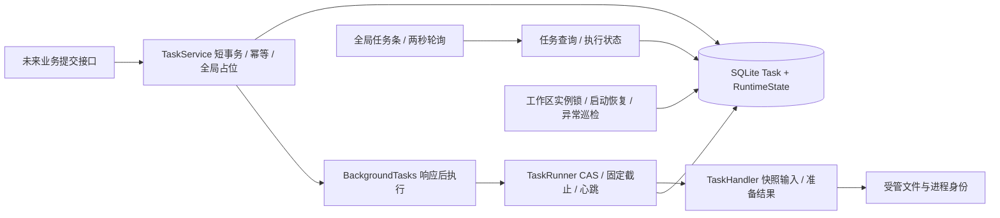

# M2 单任务引擎与恢复

2026-10-25，用户已验收M3并授权M2，本轮仅实施任务3、4、5。新增任务服务/Runner/恢复服务、任务查询与runtime接口、实例锁和进程身份保护、任务条与轮询组件及对应测试；扩充任务响应契约，修改main生命周期、数据库错误映射、OpenAPI和中文进度。不修改已有业务表，不开放通用假任务入口，不接入模型生成。

可行性复核：复用M1的活动条件唯一索引与RuntimeState、M3的不可变文件服务；提交校验与结果发布都用独立短事务。没有模型处理器时生产仅提供查询与恢复，测试通过注入处理器及测试专用HTTP端点验证202响应先于完成。恢复在任何孤立文件扫描之前取得操作系统锁，不能由轮询或连接测试推断上游空闲。

待补充：测试、审查修正、交付PR和验收证据。
