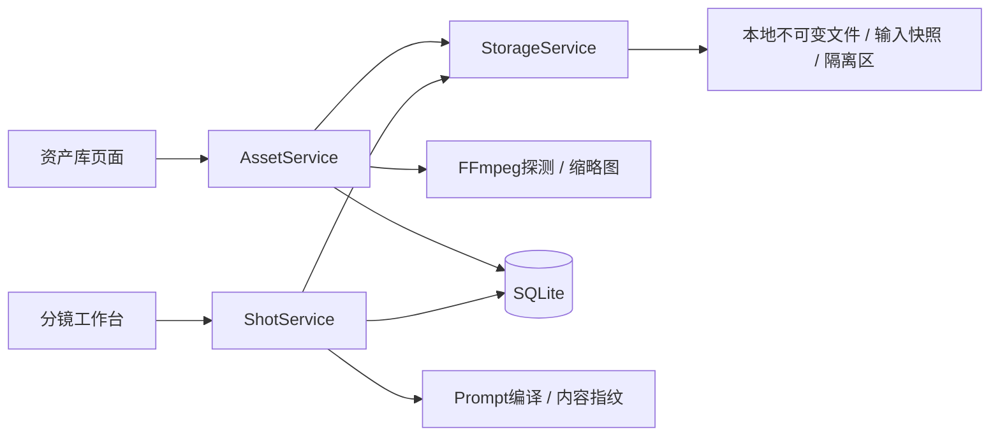

# M3 资产库与分镜工作台

用户已验收M1，本轮范围为实施计划任务6、7。新增受管文件、FFmpeg探测、资产API和资产库页面；新增分镜服务、纯提示编译/指纹、分镜API和编辑工作台；修改剧集页、OpenAPI类型、本机会话上传边界与进度文档。不修改数据库结构，不接入生成任务或模型。

可行性复核：模型未接入时仍可上传素材、手工填写三种Prompt、编排分镜、绑定参考和采用上传版本。已有Asset、Shot、Selection、引用表足够，重排复用Episode.version作为列表版本，选择同时校验Shot和Selection版本。图片规范化后登记；MP4核验保留原文件与音轨。文件处理不占用数据库写事务，提交前再次核对归档与版本。

实施状态：代码完成，进入整轮审查。M3尚未计入已验收任务。

## 功能验收

- 上传PNG/JPEG/WebP规范化为PNG；MP4探测尺寸、时长、声音并生成缩略图。图片16MiB、40百万像素，视频512MiB、最长10分钟；请求体在解析前限流，包含无Content-Length请求。
- UUID文件名、绝对受管路径、拒绝路径穿越与符号链接；完整文件原子发布后登记，登记失败隔离文件。启动巡检隔离未登记结果，不创建成功任务或资产。
- 项目资产筛选、用途多选、名称编辑、软删除、图片与视频预览下载；文件哈希异常拒绝读取，Range正常返回206，非法范围返回416。被引用或历史任务使用的素材不能删除。
- 分镜增删改、24镜上限、原子重排；图片角色/场景/其他参考最多8张，可排序和解绑，无参考图也能READY。归档项目/剧集的写操作拒绝。
- Shot与Selection双版本校验；上传素材需确认，生成素材需本镜成功任务及匹配输入指纹。首帧与视频选择独立保留，不因编辑或新素材自动覆盖。
- 文字/参数和参考图使用各自的草稿与版本基线；切镜头、刷新或409不会覆盖人工草稿。版本变化后须明确核对再重试。
- 图片哈希只包含实际风格、已选角色、Prompt、实际参考及模型参数；视频包含首帧内容、音画Prompt、对白、H3实际帧数与模型参数。标题、重排、未用素材及未用角色不误伤结果。

## 验证证据

首次测试观察到缺少StorageService、分镜API/编译器与前端组件；上传原来返回415。实现后完整回归：后端45项、前端22项通过，Ruff、TypeScript严格检查、ESLint、Prettier与Next生产构建通过。

真实Next→FastAPI链路用自制门前插画与FFmpeg颜色/正弦声音素材验收：原配置对超过12MiB的MP4报10MB截断并500；调高代理克隆上限后完整入库，SHA一致、有声音、Range206，分镜引用/采用/声音变化后的旧视频保留全部通过。没有旧数据或网络素材进入平台正式数据目录。

浏览器验证桌面1280px双栏和默认687px窄屏布局；实际修改分镜文字并保存成功，页面显示版本递增与旧视频保留。

## 实施决策

1. M1用户已验收，只实现M3任务6、7；不提前开发M2任务执行器。
2. 绑定工作树不在沙箱可写目录，继续在原仓库独立分支开发，显式指定目录；完成时同步绑定工作树。风险是漏掉显式工作目录会写入失败。
3. 技能脚本只解析英文Task标题，按中文任务段提取实施清单并记录BASE，不改已确认计划。风险是需要人工核对清单。
4. 列表读取带Episode.version；创建、删除、重排递增该版本。重排仍返回分镜列表，客户端重新读取列表版本。风险是剧本编辑也可能触发列表冲突，需要重新核对。
5. 字体、图片和视频均使用本地系统或自制素材；验收数据与正式data目录隔离。生成和H3音画协议的真实模型验收留给后续模块。

官方接口依据：[FastAPI文件上传](https://fastapi.tiangolo.com/tutorial/request-files/)、[Pillow图片接口](https://pillow.readthedocs.io/en/stable/reference/Image.html)、[ffprobe](https://ffmpeg.org/ffprobe.html)、[FFmpeg协议白名单](https://ffmpeg.org/ffmpeg-protocols.html)。
