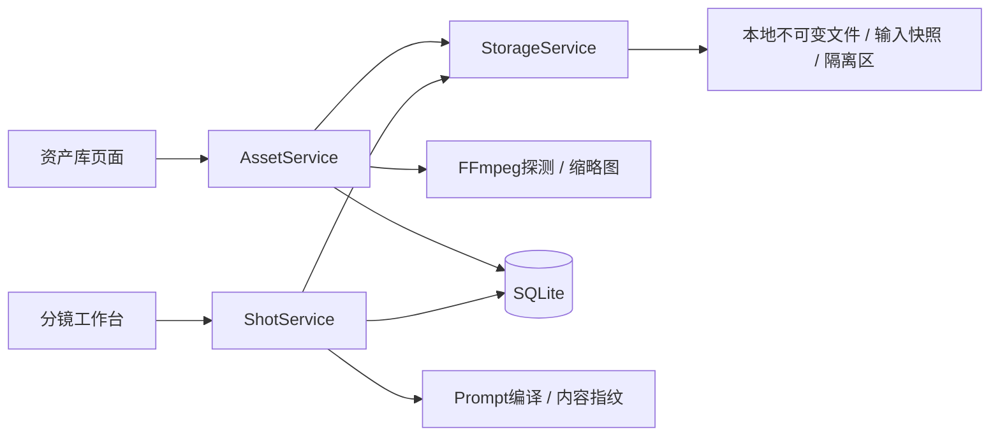

# M3 资产库与分镜工作台

用户已验收M1，本轮范围为实施计划任务6、7。新增受管文件、FFmpeg探测、资产API和资产库页面；新增分镜服务、纯提示编译/指纹、分镜API和编辑工作台；修改剧集页、OpenAPI类型、本机会话上传边界与进度文档。不修改数据库结构，不接入生成任务或模型。

可行性复核：模型未接入时仍可上传素材、手工填写三种Prompt、编排分镜、绑定参考和采用上传版本。已有Asset、Shot、Selection、引用表足够，重排复用Episode.version作为列表版本，选择同时校验Shot和Selection版本。图片规范化后登记；MP4核验保留原文件与音轨。文件处理不占用数据库写事务，提交前再次核对归档与版本。

实施状态：开发中。验收结果与审查记录在回归后补充。

官方接口依据：[FastAPI文件上传](https://fastapi.tiangolo.com/tutorial/request-files/)、[Pillow图片接口](https://pillow.readthedocs.io/en/stable/reference/Image.html)、[ffprobe](https://ffmpeg.org/ffprobe.html)、[FFmpeg协议白名单](https://ffmpeg.org/ffmpeg-protocols.html)。
