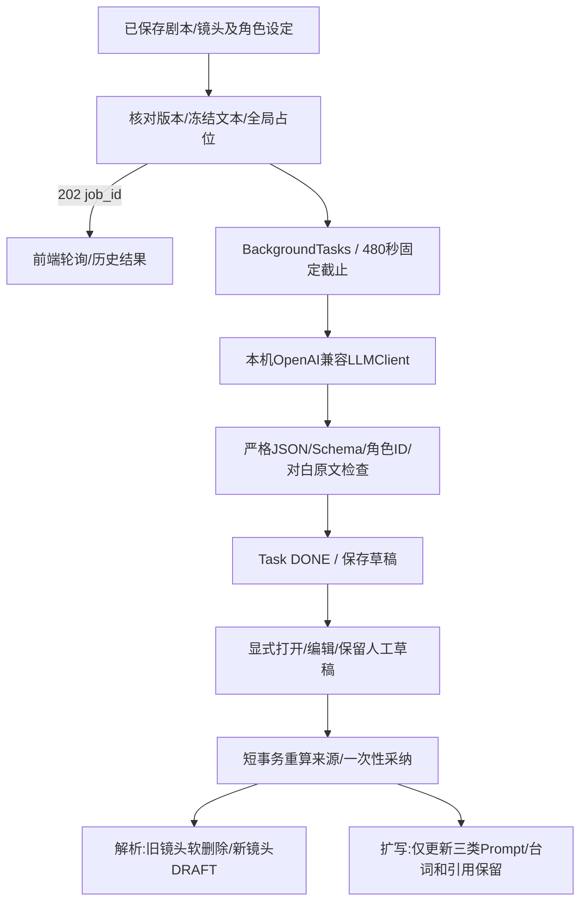

# M4 本地剧本解析与 Prompt 辅助

日期：2026-10-26。状态：实现、独立审查修正与回归完成，待用户验收。M7已获用户验收；本轮仅任务8，M8未开始。

## 方案与新增/修改文件

新增后端`clients/llm.py`、`services/storyboards.py`、`schemas/storyboards.py`及协议、后台任务和采纳测试；新增前端`features/storyboards/ScriptParser.tsx`、`PromptAssistant.tsx`、`DraftReview.tsx`及共享任务面板、文本模型设置和组件测试。修改jobs业务路由、settings连接测试、处理器注册、项目/分镜工作台、Zustand草稿和OpenAPI类型。

## 可行性审查

- 复用M2全局任务槽、幂等、停止状态和480秒总截止。文本结果生成只写Task，不创建镜头、不调用图像或视频模型。
- 结构化结果严格拒绝重复键、非有限数、截断、额外字段、伪造资产/角色ID；剧本1～12000字，解析1～24镜，目标1～8秒。Qwen reasoning_content仅对已验证完整模型ID作整体JSON解析，不截取说明或思考文本。
- 本机HTTP只允许回环、禁代理/重定向，保留TLS证书身份。连接检查仅读模型列表。已明确终止的无效结果可释放；断连、截断且无上游终止证据时保留NEEDS_RESET。
- 解析主要建立原始描述、台词、角色和声音要求，不臆造专业Prompt，新镜头初始DRAFT。LLM提取台词必须是剧本的连续原文；用户审阅后可自行修改。
- 扩写仅生成三类英文镜头描述，台词由现有编译器原文注入。全局风格由编译器统一添加，不让模型重复扩写；角色只使用本镜已选角色，参考图仍须人工绑定。
- 采纳需目标版本及相关项目设定匹配。解析还比较活动镜头的ID/版本，防止单镜编辑未递增Episode.version时被旧解析替换。旧镜头/引用/选择/资产/任务全部保留。
- 草稿审阅与原始表单分别保存在Zustand。自动轮询不打开结果、不覆盖表单；未知POST或403只复用原幂等意图，采纳不自动重发。存在未保存人工编辑时禁止采纳。
- 不迁移旧数据，不修改数据库结构、不检测内存、不管理模型。实测使用独立目录，正式data保持未创建。

## 验证记录

协议回归、独立审查及本机模型/浏览器演示完成，详细证据如下。

## 自动化与独立审查

- 后端全量216项通过，最终18.87秒；M4协议/后台任务/采纳专项38项。前端全量58项通过，其中M4组件7项、解析后延迟刷新回归1项。Ruff检查与格式、TypeScript strict、ESLint、Prettier和Next.js生产构建通过。
- 真实Next→FastAPI来源边界、伪造转发头拒绝、>10MiB媒体上传SHA与音轨保留、Range206、引用/采用/过期回归通过。单个测试和构建均经30、60、120或540秒总截止包装。
- 一次独立全分支只读审查（702b29c..0fbaf86），精确Qwen兼容扩展与M2取消修正均无阻塞。一个Important：解析采纳后自动刷新延迟返回，可能回退刚保存的镜头界面。已用“延迟素材响应＋手工刷新＋保存新镜头”稳定复现，再修正读取先后顺序及版本合并，镜头与素材都不回退；前端58/58、后端216/216随后通过。无Critical、无遗留Minor；没有派发第二次审查。
- 真实全量回归另发现M2既有取消竞态：任务已DONE，心跳收尾I/O恰好失败时，原CancelledError被AppError替换，心跳继续循环导致收尾等待。已中断本轮挂起测试，通过“取消中线程抛AppError”稳定RED→GREEN修正，仍等待真实线程结束并保留原取消；任务截止/心跳/关停/恢复25项及全量回归均通过。
- 浏览器另发现采纳成功后审阅区退回显示原模型稿，正式数据其实正确。已补组件断言并修复，采纳后的审阅显示保留人工修订值，重新加载也读取服务端applied_value。

## 真实本机模型与浏览器验收

服务为已运行的本机LM Studio/OpenAI兼容HTTP（1234），使用模型`qwen3.8-27b-mlx@8bit`。检查仅读模型列表，未发送模型管理请求，也没有内存探测或云调用；H3与Draw Things服务未调整。

首轮调用按旧精确模型白名单拒绝了空正文响应，任务FAILED且服务确认终止后安全空闲。单独核对真实协议：finish_reason=stop、content为空、reasoning_content为完整JSON（454字符），整体结构、角色ID和台词原文均通过严格校验后，才将该精确8bit ID加入兼容；旧已验证别名继续保留，4bit及其他变体没有继承此规则。

| 验收步骤 | 真实结果 |
|---|---|
| 保存原创剧本及角色 | 44字；橄榄绿木制机器人“小木”，橙围巾；风格为暖色手工微缩摄影、纸质布景 |
| 解析请求 | 约0.019秒返回202/job_id，约8.07秒完成；生成两镜，正式分镜仍为空 |
| 人工审阅 | 修改第一镜画面为“轻敲两下后停手等待”，修订第二镜声音为环境与开门声，保留“早上好。”原文 |
| 明确采纳解析 | 创建两镜，初始DRAFT；没有生图/视频Prompt或自动媒体生成 |
| 第二镜三类Prompt扩写 | 约5.71秒完成，image/video/audio为英文；正式镜头保持原值直到明确采纳 |
| 人工采纳Prompt | 修改为固定机位、连续镜头、保留方头与橙围巾后采纳；镜头version=2且READY |
| 原文和风格核验 | 台词仍为“早上好。”；完整H3 Prompt包含原文对白，图像完整Prompt仅注入一次全局风格 |
| 保留与恢复 | 两次任务均记录applied_at、重复采纳被禁止；页面重载可恢复已保存内容及历史审阅，无控制台警告/错误 |
| 媒体边界 | 未创建图片/视频资产，引用与首帧/视频选择保持空；模型结果只作为文本草稿 |

AI的语义仍通过人工审阅确认；本次在采纳前修订了声音描述，保证对白继续由独立原文字段注入。没有把协议结构校验等同于内容质量自动通过。

演示全部使用独立`.superpowers/m4-preview-data`。原创结果样例：[分镜与Prompt JSON](media/m4-storyboard-and-prompts.json)；[解析稿编辑截图](images/m4-draft-review.png)、[已采纳Prompt截图](images/m4-prompt-review.png)。正式`data/`未创建，无旧数据迁移，无数据库迁移。

## 实施裁决与代价

按本轮决定顺序保留全部裁决：

1. 沿用可写原仓库独立功能分支并同步附加worktree，原因是附加工作区沙箱限制已验证；代价为额外同步步骤。
2. 解析采纳额外比较活动镜头ID/版本，避免单镜编辑未递增Episode.version时误替换人工修改；代价是解析后编辑现有镜头须重新生成解析稿。
3. reasoning_content只增加精确`qwen3.8-27b-mlx@8bit`兼容，依据真实stop及整体严格校验；代价是4bit及其他变体仍不能使用空正文兼容，已获独立兼容审查。
4. 本轮同时修复M2既有取消竞态，避免DONE任务收尾一直等待；代价是增加公共runner与截止测试改动，已随本轮完整审查和回归。
5. 未变更的媒体发布崩溃窗口与混合音画拼接沿用M5～M7验收，本轮验证公共runner及既有自动回归；代价是没有重新演示整条真实媒体制作链路。
6. 文档最终状态与验收证据由实施者核对收尾；代价是文档没有再次独立复审。
7. M8整体验收留待下一轮用户授权；代价是完整闭环与首版交付仍未计完成。

## 交付状态

M4任务8实现、独立审查修正、回归和真实模型/浏览器验收完成，待用户验收。[草稿PR #8](https://github.com/yyl1212/video_maker/pull/8)，基于未合并的M7分支，未自动合并。已实现11/12、已验收10/12；已验收用户故事10/14（US01～US10），US11/US12随M4等待验收。下一项为M8任务12，尚未开工。

本轮临时前后端及浏览器标签将在收尾停止/关闭，独立演示数据和证据保留；不停止用户模型服务。
