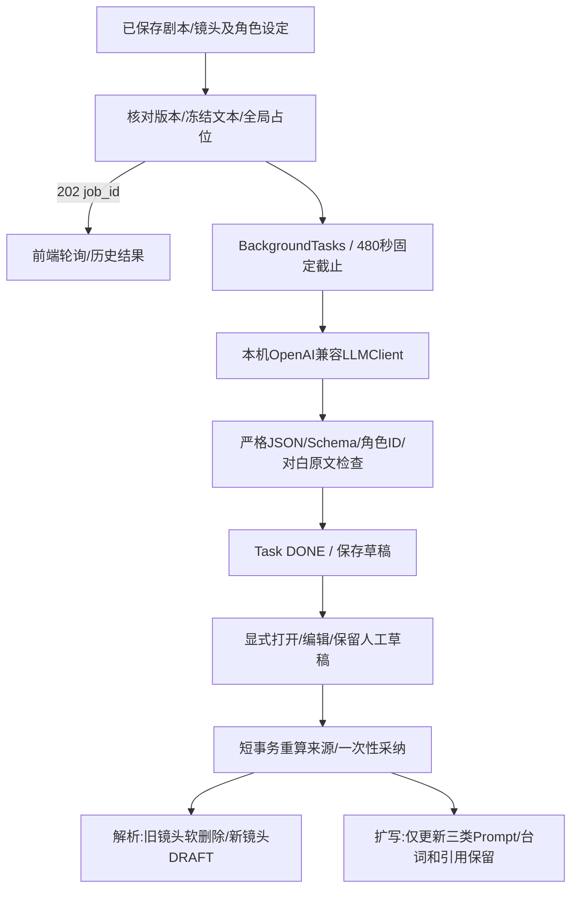

# M4 本地剧本解析与 Prompt 辅助

日期：2026-10-26。状态：开发中。M7已获用户验收；本轮仅任务8，M8未开始。

## 方案与新增/修改文件

新增后端`clients/llm.py`、`services/storyboards.py`、`schemas/storyboards.py`及协议、后台任务和采纳测试；新增前端`features/storyboards/ScriptParser.tsx`、`PromptAssistant.tsx`、`DraftReview.tsx`及共享任务面板、文本模型设置和组件测试。修改jobs业务路由、settings连接测试、处理器注册、项目/分镜工作台、Zustand草稿和OpenAPI类型。

## 可行性审查

- 复用M2全局任务槽、幂等、停止状态和480秒总截止。文本结果生成只写Task，不创建镜头、不调用图像或视频模型。
- 结构化结果严格拒绝重复键、非有限数、截断、额外字段、伪造资产/角色ID；剧本1～12000字，解析1～24镜，目标1～8秒。Qwen reasoning_content仅对已验证完整模型ID作整体JSON解析，不截取说明或思考文本。
- 本机HTTP只允许回环、禁代理/重定向，保留TLS证书身份。连接检查仅读模型列表。已明确终止的无效结果可释放；断连、截断且无上游终止证据时保留NEEDS_RESET。
- 解析主要建立原始描述、台词、角色和声音要求，不臆造专业Prompt，新镜头初始DRAFT。LLM提取台词必须是剧本的连续原文；用户审阅后可自行修改。
- 扩写仅生成三类英文镜头描述，台词由现有编译器原文注入。全局风格由编译器统一添加，不让模型重复扩写；角色只使用本镜已选角色，参考图仍须人工绑定。
- 采纳需目标版本及相关项目设定匹配。解析还比较活动镜头的ID/版本，防止单镜编辑未递增Episode.version时被旧解析替换。旧镜头/引用/选择/资产/任务全部保留。
- 草稿审阅与原始表单分别保存在Zustand。自动轮询不打开结果、不覆盖表单；未知POST或403只复用原幂等意图，采纳不自动重发。存在未保存人工编辑时禁止采纳。
- 不迁移旧数据，不修改数据库结构、不检测内存、不管理模型。实测使用独立目录，正式data保持未创建。

## 验证记录

待补充协议回归、独立审查及本机小剧本演示。
