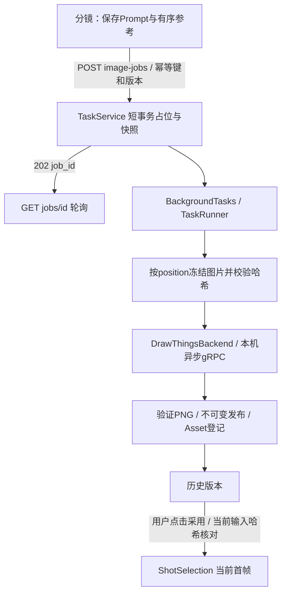

# M5 首帧生成接入

状态：实现与真实模型演示完成，整分支审查/回归中。范围为任务9；M2已获本轮用户验收，M6尚未开始。

## 方案与文件

新增 `backend/app/clients/drawthings.py`、`backend/app/services/generation.py`、图像生成请求契约、前端 `ImageGenerationPanel.tsx` 和连接配置组件，以及对应后端与前端测试。修改分镜生成路由、默认处理器注册、连接检查、图像输入指纹和 OpenAPI 类型；沿用资产发布、任务锁、轮询和显式采用接口，无数据库迁移。

## 可行性和兼容性决定

- 固定 `drawthings-py==0.4.0`，已确认支持当前 Python 3.13。复用 SDK RequestBuilder、moodboard 和张量编解码；按属性 `is not None` 转换，保留 false/0。实际 flatbuffer 再覆盖 seed，避免 SDK 将 0 随机化。配置和参考顺序由协议测试审查。
- 使用 SDK 生成的异步 gRPC stub，保留 Draw Things 证书信任；TLS可配置。SDK 的便捷服务不暴露TLS选择，且无图/异常终止路径无法用于判断远端是否停止，因此不直接包裹该便捷服务。
- 压缩由 Draw Things 服务端控制，客户端张量解码兼容两种格式；现有 `compression` 字段仅表达服务端预期，不伪装为可控制的RPC开关，界面明确提示。
- 首版生图仅启用旧项目已验证的 `flux_2_klein_9b_kv_i8x.ckpt` 配置：单张、sampler16、shift3、seedMode2，关闭高分修复、分块解码/扩散和分辨率相关shift。固定协议配置一并纳入图像输入指纹。无参考也可生成，参考最多8张；其他模型暂拒绝，后续通过独立profile验证后扩展。
- 尺寸必须是64的倍数，避免SDK四舍五入导致实际尺寸与快照不符；在生成入口清楚提示，既有分镜仍可编辑。
- Echo检查加文件存在性RPC只读取本机模型与文件列表（兼容Echo仅返回HELLO、不带目录的服务版本），不生成、不下载模型、不更改模型运行状态、不解除 NEEDS_RESET。
- 生成前先完成Echo、输入编码和配置检查，再持久化远端开始标记；只有流正常结束后标记远端停止。超时或断流后无法确认上游停止时，任务FAILED且运行状态NEEDS_RESET。
- 当前选择始终由用户显式采用；生成时继续编辑不会改变快照，旧结果仍存历史并被指纹规则阻止误采用。文件发布后数据库提交失败由启动扫描隔离孤立结果，不删除既有资产。

依据：[SDK作者文档](https://github.com/kcjerrell/drawthings-py)及本机安装的0.4.0源码；旧项目 `drama.py` 的已验证配置转换与moodboard顺序。

## 验证记录

- 首次真实请求：2026-10-25，任务#1，256×384、4步、seed0、1张自制机器人参考图。202响应约0.004秒，含两秒轮询的验收约10.06秒完成；模型任务实际约8.82秒。
- 初次生成后 `ShotSelection.first_frame_asset_id=null`；界面明确采用资产#2后，发起任务#2重生成，新建资产#3，选择仍为资产#2；刷新页面恢复任务结果与同一选择，没有重发生成。
- 参考顺序、角色用途、asset_id、原图SHA和冻结路径保存到生成Asset元数据，实际flatbuffer的seed0/false/尺寸与多参考顺序有协议断言。
- 自制参考：[图片](images/m5-reference.png)；实际生成：[首帧](images/m5-first-frame.png)；界面证据：[工作台截图](images/m5-workbench.png)。图片仅为技术链路验收，最终审美由用户决定。
- 验收数据位于忽略目录 `.superpowers/m5-preview-data`，正式 `data/` 未写入演示数据；没有迁移旧数据。
- 自动化与独立审查结论在交付时补齐。
