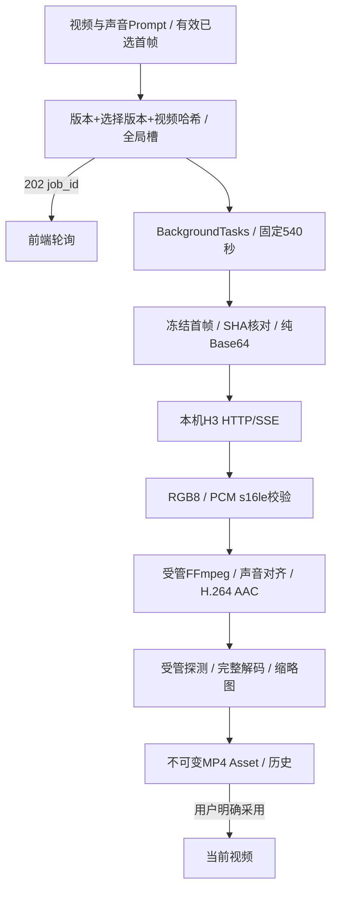

# M6 MiniMax-H3 原生音画生成

日期：2026-10-25。状态：实现及真实模型演示完成，独立审查/回归中。本轮仅任务10，M5已获用户验收；M7尚未开始。

## 方案与文件

新增 `backend/app/clients/minimax_h3.py`、`backend/app/media/video_profile.py`、协议/音画封装/视频任务测试；前端新增 `VideoGenerationPanel.tsx`、视频连接设置及测试；提取通用 `ShotGenerationPanel.tsx` 共用M5已验证的幂等提交和轮询。修改generation处理器注册、视频提交路由、连接检查、FFmpeg异步编码与核验、H3提示编译、OpenAPI类型与工作台入口。沿用Task、Asset和ShotSelection，无数据库迁移。

## 可行性与兼容方案

- 复用旧项目 `app/video_model.py`、`app/videos.py` 已验证的 `/v1/video/generations` 和progress/error/complete字段；独立异步客户端，不导入旧运行时。已只读验证本机H3存在。HTTPX2 2.16升级为生产依赖，禁用环境代理与重定向，仅连接本机回环。
- 仅适配 `ddalcu/MiniMax-H3-FL2VA-MLX-Serve-8bit`；quality=20步/非Turbo，fast=4步/Turbo；目标1～8秒，实际17k+5帧（k=1～11）、24fps。尺寸为32倍数，短边≤384、长边≤672；使用已保存配置，不按首帧暗中重算。
- Prompt按 `<Picture 1>`、`integrated_multimodal_description`、`overall_soundscape`、`non_diegetic_music` 分区，台词保持原文；实际采样和固定编码规格纳入视频指纹。
- 首帧从有效选择冻结，Base64对应原资产SHA；浏览器不能提交路径或Base64。过期首帧、选择版本或输入变化在占位事务内拒绝。
- SSE按字节有界接收，处理跨块/CRLF；256MiB为协议响应上限，不是内存检测。540秒覆盖读取、HTTP、解码、编码、探测及发布，进度不重置截止；推理读取不另设短空闲超时，避免正常模型静默阶段被截断，连接/预检仍有8秒上限。
- RGB尺寸/帧数/fps/格式/字节数严格匹配；PCM要求s16le、1/2声道、8000～96000Hz、非空且采样完整。音频缺失或音画差>0.5秒失败；合法差异补静音/裁切，封装AAC 48kHz双声道，保留原生声音内容。
- 未收到终止证据而断流/超时为FAILED+NEEDS_RESET；明确模型拒绝或终止后的本地失败安全释放。连接检查仅GET模型列表，不生成、不解除恢复限制。
- 编码、探测、完整解码及缩略图通过TaskContext受管子进程，文件/数据库通过runner.io；不复用旧_prepare、内存估算、metrics、load-model、unload-model或恢复逻辑。
- 任务结束清理本任务RGB/PCM/编码副本，冻结首帧与不可变资产保留。结果只加入历史，不替换当前选择。执行中编辑不改变快照，采用继续核对当前视频输入指纹。

依据：[HTTPX2作者文档](https://github.com/pydantic/httpx2)、已安装2.16源码和旧项目已验证H3代码；其他MLX项目的搜索结果不视为本机服务的协议承诺。

## 验证记录

- 完整后端157项通过（8.63秒），前端44项通过，严格类型、lint、格式及生产构建通过；新增协议29项、音画封装16项、视频任务11项和前端5项。
- 真实H3：自制机器人首帧，256×384，fast/4步，seed42；目标2秒，实际56帧/24fps=2.333333秒。202响应0.0038秒，含轮询、编码及核验约20.13秒。
- 原生PCM：s16le、32000Hz、双声道、2.325秒；按实际视频时长补齐后封装AAC 48000Hz双声道，音视频流均为2.333333秒。已完整解码，没有丢弃声音。
- 首帧Asset及冻结副本SHA一致；结果只入历史，首次生成后当前视频仍为空。任务RGB/PCM文件已清理。隔离目录 `.superpowers/m6-preview-data`，正式data未写演示内容。
- 浏览器已明确采用资产#2并播放至结束（currentTime=duration=2.333333，readyState4，error=null）；界面显示“有声音”。已发起同镜重生成，后续补充选择保持与刷新证据。
- 实测MP4保留在 `.superpowers/m6-results/m6-robot-native-audio.mp4`，非正式数据；最终声音自然度、台词准确度及画面质量由用户播放确认。
