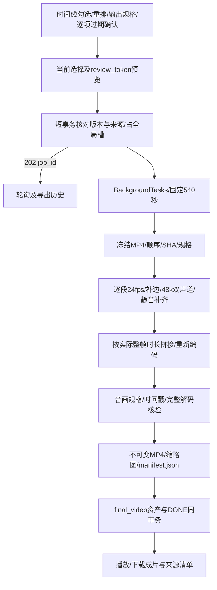

# M7 成片导出

日期：2026-10-25。状态：已于2026-10-26获用户验收，随后按用户指令进入M4。本文记录M7任务11交付证据。

## 方案与文件

新增 `backend/app/services/exports.py`、`backend/app/schemas/exports.py`、导出路由、时间线快照及音画拼接测试；前端新增 `ExportTimeline.tsx`、`ExportHistory.tsx`、剧集export页面与测试。修改FFmpegService的异步normalize_clip/concat、EXPORT注册、工作台入口及接口类型。沿用既有Task/Asset/ShotSelection，不迁移数据库。

## 可行性与兼容方案

- 默认包含全部活动镜头的当前视频；缺失或损坏片段逐镜提示，不自动跳过。用户可取消勾选或重排，首版最多24镜。
- 过期片段须逐项确认；确认绑定该行review_token，覆盖资产ID/SHA、选择与分镜版本、当前图像/视频输入及过期状态。项目/剧集版本也在提交事务核对；来源变化后不能自动继承旧确认。令牌为服务端签名预览，写事务仅检查指纹、版本和轻量文件状态；完整SHA在预览及后台冻结验证，避免大视频哈希阻塞写事务。重启后未接收的旧预览需手动刷新，已接收的请求仍先按幂等键返回。
- 新导出必须使用当前选择；执行开始后，后续改分镜顺序、输入或选择不会修改已冻结清单。幂等重试仍返回同一任务，图像/视频/导出共用一个制作槽。
- 输出为720×1280、1280×720或720×720；H.264/yuv420p/24fps、AAC/48000Hz/双声道。按显示比例缩放并补黑边，处理非方形像素，不裁切或拉伸人物。
- 源时长量化到最近24fps整帧，非空极短片段至少保留一帧；记录原时长、整帧数与规范化时长，单段偏差不超过一帧。每段从零时间戳开始，保留音画相对起点，声音按整帧时长补齐/裁切；无声段补静音。
- 先逐段规范化，再用音视频concat滤镜拼接并重新编码；逐段音频按精确采样数裁切，避免把AAC填充累加到下一段。总时长与规范化片段之和比较，误差≤0.15秒，不与原始浮点时长和混用。
- 全部编码、探测、完整解码和缩略图由TaskContext受管子进程执行，文件操作通过runner.io，共享540秒截止。参数用数组，无shell用户文本拼接。
- MP4及缩略图沿用不可变media发布；清单在jobs/id/manifest.json原子只读发布，路径和SHA入Asset元数据，启动扫描不会误隔离。下载只按同项目已完成EXPORT任务对应的输出资产解析固定任务路径并验证SHA，不接受路径参数。
- 文件发布后数据库失败不伪装DONE；media孤立结果按原启动流程隔离，任务清单只有成功资产可下载。多次导出文件独立，原视频选择与历史成片保留。
- 前端轮询仅更新任务/历史，不覆盖时间线草稿。手动刷新来源须明确采纳，保留重排顺序并清除过期确认；未知提交及403恢复沿用原幂等键。

依据：[FFmpeg官方滤镜文档](https://ffmpeg.org/ffmpeg-filters.html)和本机CLI帮助。scale reset_sar、concat、aresample first_pts及按采样裁切将通过真实自制片段验证。

## 验证记录

已完成自动化、独立审查和浏览器导出/下载演示，记录如下。正式data不写入测试数据，不调用模型生成。

## 自动化与审查结果

- 后端全量：177项通过，16.67秒；其中M7来源快照/导出19项。前端全量：50项通过，其中导出6项覆盖排序、缺片段、来源刷新、旧确认失效、未知提交与403、归档下载、切页面保留草稿。
- Ruff检查及格式、TypeScript strict、ESLint、Prettier和Next.js生产构建通过；真实Next→FastAPI的Host/转发头、>10MiB上传、SHA/音轨/Range206及参考/采用回归通过。单个测试/构建命令均经120或540秒总截止包装。
- 一次独立全分支只读审查，范围`b67d5fc..a40ac83`。发现两个Important：final_video未加入既有标签契约导致成片改名422；清单资格依赖可编辑标签，删除标签后下载404。两项均先用真实FFmpeg+HTTP测试复现失败，再修正为通过，随后全量177/177回归。Critical、遗留Minor、Declined to judge均无；未重复派发审查。
- 兼容修正：AssetTag增加final_video及第六个用途选项，资产库可以改名和调整全部用途；清单资格由稳定的EXPORT/DONE任务、output_asset_id、项目归属及固定路径/SHA决定，用途标签不参与身份判断。无数据库迁移；默认Shot文件核验仍为完整SHA，轻量检查只用于已签名预览的导出提交。

## 真实演示与可复核文件

使用独立`.superpowers/m7-preview-data`，未创建正式`data/`。两个原创标题卡片由本机绘制，机器人片段复用本项目M6已实测的原创生成结果；没有导入旧项目数据，也没有再次调用模型。

| 时间线位置 | 来源 | 原规格与声音 | 原时长 / 输出时长 |
|---|---|---|---|
| 1 | 原创片头（镜头2） | 960×540 / 30fps / 无声 | 1.000 / 1.000秒 |
| 2 | 原创机器人（镜头1） | 256×384 / 24fps / H3原生声音 | 2.333333 / 2.333333秒 |
| 3 | 原创片尾（镜头3） | 720×720 / 25fps / AAC44100Hz单声道 | 1.200 / 1.208333秒 |

浏览器将片头上移至首位，点击导出，先看到PENDING/RUNNING后台状态，随后出现可播放、下载的独立成片。实际播放到结束：`currentTime=duration=4.541667`、`ended=true`，无媒体错误。已点击下载MP4与来源清单；Next→FastAPI真实下载返回attachment，MP4和JSON SHA分别与Asset记录一致。导出未更改各ShotSelection。

重复导出实测：202响应约0.0069秒，完整导出约1.90秒；同幂等键返回同job_id，新意图并发返回429。两次导出拥有不同MP4和清单路径，第一份原文件SHA保持不变。重启后第一份清单仍可下载。在最终构建资产库中改名并清空用途标签后，历史仍可见，清单仍200。

交付样例：[MP4](media/m7-original-short-film.mp4)、[原始来源清单](media/m7-original-short-film.manifest.json)、[浏览器截图](images/m7-export.png)。清单记录隔离演示目录的绝对路径与原始SHA，便于追溯本次实测。

最终规格为720×1280、109帧、H.264/yuv420p/24fps、AAC48000Hz双声道，音视频起点均为0，总时长4.541667秒，大小527421字节。三个片段内部采样区间的单声道PCM RMS依次为0.00、565.71、2045.62：静音段确实无声，机器人原生声音及片尾音均保留。完整解码通过；成片SHA256：`2def1e259c47b06515d65b2007d48a3dc6d50d1b593997aa85958e1853c26d9e`。

## 实施裁决与代价

按决策顺序保留本轮全部裁决：

1. 沿用可写原仓库独立功能分支并同步附加worktree，原因是已验证沙箱限制；代价为额外同步步骤。
2. 过期确认绑定服务端review_token，覆盖源资产SHA、选择/分镜版本、当前图像/视频指纹与过期状态，防止输入变化误用旧确认；代价是来源变化须显式刷新、重新确认。
3. manifest在任务目录原子只读发布，路径与SHA写Asset元数据，避免media启动扫描误隔离；代价是未登记任务的孤立清单留待后续清理，不能作为成功成片下载。
4. 采用签名预览，提交只核对指纹/版本/轻量文件状态，完整视频SHA在预览及后台冻结验证，避免大文件哈希占住SQLite写事务；代价是重启后未接收的旧预览须显式刷新，已接受意图仍先按幂等键查询。
5. normalize_clip返回含MediaInfo的NormalizedClip，额外携带精确整帧数与原时长，用于按采样对齐音轨；代价是内部调用多一层包装，无既有外部接口变动。

## 交付状态

M7任务11完成，已获用户验收。[草稿PR #7](https://github.com/yyl1212/video_maker/pull/7)，基于未合并的M6分支；没有自动合并。M7交付时已实现10/12、已验收9/12；本轮用户确认M7后，已验收增至10/12、用户故事10/14（US01～US10）。用户已于2026-10-26确认并授权M4任务8；当前进度见敏捷看板，M8尚未开工。

本轮临时前后端服务将在收尾停止；保留独立演示数据、原创MP4、来源清单和截图。正式模型服务不做卸载、停止或配置变动。
