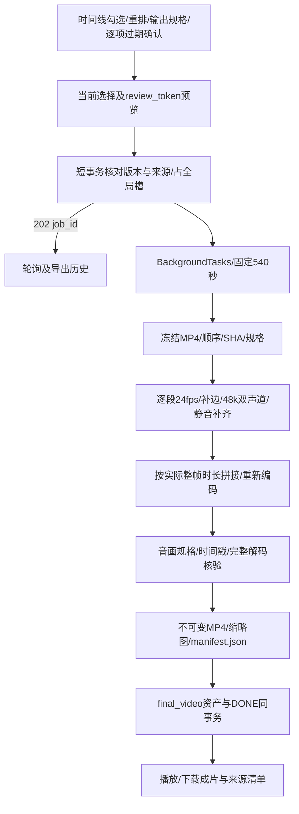

# M7 成片导出

日期：2026-10-25。状态：开发中。M6已获用户验收；本轮仅任务11，M4与M8未开始。

## 方案与文件

新增 `backend/app/services/exports.py`、`backend/app/schemas/exports.py`、导出路由、时间线快照及音画拼接测试；前端新增 `ExportTimeline.tsx`、`ExportHistory.tsx`、剧集export页面与测试。修改FFmpegService的异步normalize_clip/concat、EXPORT注册、工作台入口及接口类型。沿用既有Task/Asset/ShotSelection，不迁移数据库。

## 可行性与兼容方案

- 默认包含全部活动镜头的当前视频；缺失或损坏片段逐镜提示，不自动跳过。用户可取消勾选或重排，首版最多24镜。
- 过期片段须逐项确认；确认绑定该行review_token，覆盖资产ID/SHA、选择与分镜版本、当前图像/视频输入及过期状态。项目/剧集版本也在提交事务核对；来源变化后不能自动继承旧确认。令牌为服务端签名预览，写事务仅检查指纹、版本和轻量文件状态；完整SHA在预览及后台冻结验证，避免大视频哈希阻塞写事务。重启后未接收的旧预览需手动刷新，已接收的请求仍先按幂等键返回。
- 新导出必须使用当前选择；执行开始后，后续改分镜顺序、输入或选择不会修改已冻结清单。幂等重试仍返回同一任务，图像/视频/导出共用一个制作槽。
- 输出为720×1280、1280×720或720×720；H.264/yuv420p/24fps、AAC/48000Hz/双声道。按显示比例缩放并补黑边，处理非方形像素，不裁切或拉伸人物。
- 源时长量化到最近24fps整帧，非空极短片段至少保留一帧；记录原时长、整帧数与规范化时长，单段偏差不超过一帧。每段从零时间戳开始，保留音画相对起点，声音按整帧时长补齐/裁切；无声段补静音。
- 先逐段规范化，再用音视频concat滤镜拼接并重新编码；逐段音频按精确采样数裁切，避免把AAC填充累加到下一段。总时长与规范化片段之和比较，误差≤0.15秒，不与原始浮点时长和混用。
- 全部编码、探测、完整解码和缩略图由TaskContext受管子进程执行，文件操作通过runner.io，共享540秒截止。参数用数组，无shell用户文本拼接。
- MP4及缩略图沿用不可变media发布；清单在jobs/id/manifest.json原子只读发布，路径和SHA入Asset元数据，启动扫描不会误隔离。下载只按已完成的同项目final_video资产解析固定任务路径并验证SHA，不接受路径参数。
- 文件发布后数据库失败不伪装DONE；media孤立结果按原启动流程隔离，任务清单只有成功资产可下载。多次导出文件独立，原视频选择与历史成片保留。
- 前端轮询仅更新任务/历史，不覆盖时间线草稿。手动刷新来源须明确采纳，保留重排顺序并清除过期确认；未知提交及403恢复沿用原幂等键。

依据：[FFmpeg官方滤镜文档](https://ffmpeg.org/ffmpeg-filters.html)和本机CLI帮助。scale reset_sar、concat、aresample first_pts及按采样裁切将通过真实自制片段验证。

## 验证记录

待补充自动化、独立审查和浏览器导出/下载演示。正式data不写入测试数据，不调用模型生成。
