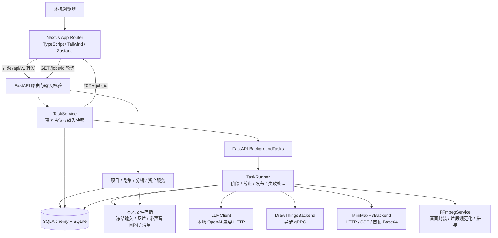
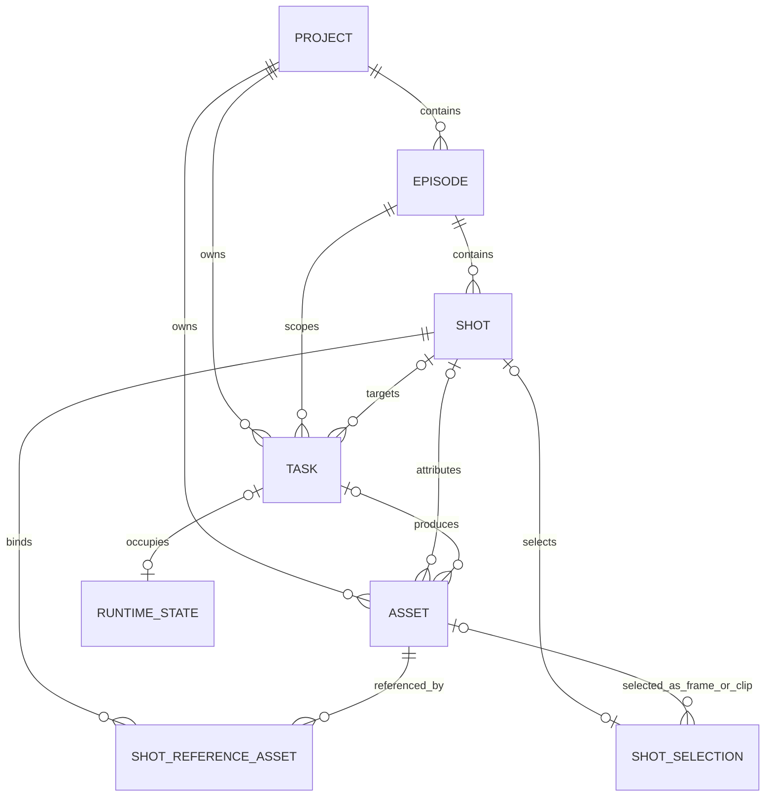
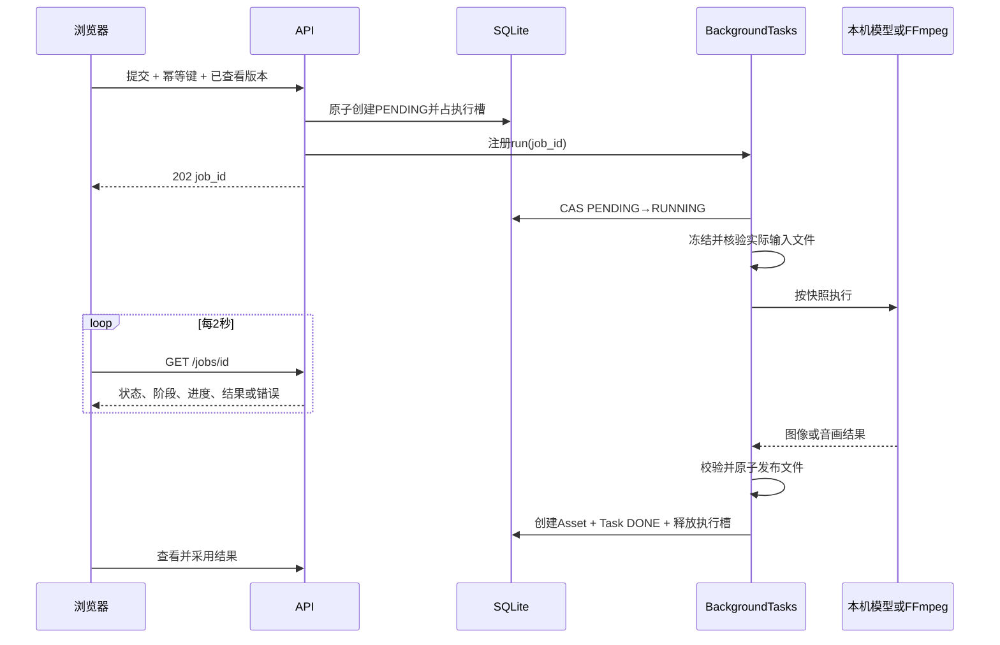

# 本地 AI 短视频制作平台：产品与架构设计

日期：2026-10-25。状态：M1、M3、M2已获用户验收；M5首帧实现、独立审查修正与回归完成，待用户验收。证据见[M5首帧验收](../../M5首帧生成验收.md)，其余模块仍按用户指令分步推进。

## 1. 已确认的目标与边界

在 Apple Silicon Mac 上运行单机、单用户、完全本地的短视频制作平台。用户从项目和剧本出发，维护素材与分镜，逐镜生成首帧及带声音的视频，最后按选定顺序导出 MP4。

已确认：

- 新平台位于 `video_maker`，从空数据库和空资产目录开始；不迁移 DrawThings 项目、分镜、资产或历史记录。
- 允许复用旧项目已经验证的模型协议、提示编译经验与测试；不直接搬入旧工作台及其状态机。
- Next.js App Router、TypeScript 严格模式、Tailwind CSS、Zustand；FastAPI、SQLAlchemy、SQLite。
- 使用 FastAPI `BackgroundTasks`；不用 Celery、Redis、消息队列或浏览器长连接进度推送。
- 全局同时最多一个耗时制作任务；不提供排队，忙时返回 429。
- MiniMax-H3 同时生成视频和音频；保留音轨、封装 MP4，导出时保留每段声音。
- 默认内存足够；不做内存检测、显存估算、内存阈值门禁，也不自动卸载或恢复其他模型。
- 图片、视频存在本地磁盘；数据库保存绝对文件路径和元数据，不保存媒体 Base64/BLOB。
- 每次只实现用户指定的一个阶段，阶段审查、回归及用户确认后再继续。

交付按[敏捷进度编排](../plans/2026-10-25-agile-delivery.md)滚动推进：先可编辑工作台，再参考首帧、H3音画和成片导出，随后补齐LLM辅助，最后进行首版整体验收。该顺序不改变产品范围；各模块仍需用户指定和验收后继续。

首版不包含：多用户、云调用、跨设备同步、旧数据迁移、自动整集生成、尾帧约束、复杂图片审核状态机、人物轮廓布局、独立 TTS、声音克隆、精确口型、字幕编辑、转场和多轨剪辑。H3 的原生声音属于首版能力，台词的逐字准确性和口型仍由用户播放验收。

## 2. 路线选择与可行性

| 路线 | 收益 | 成本与结论 |
|---|---|---|
| 新架构重建，复用已验证的协议和测试 | 数据及职责边界清楚，符合新 PRD，不承担旧数据兼容 | 需要新 UI、数据库和任务层；采用此路线 |
| 原工作台整体搬迁后替换技术栈 | 短期看似保留更多功能 | 引入旧 API、JSON 正式数据和审核状态等包袱，与空数据、新产品范围不符；不采用 |
| 独立常驻任务进程与持久化队列 | 适合多任务和跨进程恢复 | 超出单任务及 BackgroundTasks 约束；不采用 |

所选路线是用户确认的新平台建设方式。用户已确认开始M1，后续模块须按敏捷编排分别授权和验收。

`BackgroundTasks` 在 HTTP 响应之后执行，适合本平台把外部模型 I/O 放到后台，但它不是持久化队列。进程中止时不承诺任务继续或自动重放。数据库约束、单实例锁、启动恢复和输入快照共同补齐可靠性；不能只靠内存布尔锁。

## 3. 优化后的产品定义

### 3.1 项目、剧集与设置

- 项目维护名称、全局风格、结构化角色设定，支持归档和恢复。
- 角色设定使用带稳定 `id` 的 JSON 数组，字段为 `id/name/description`；本期不单独建立角色表。
- 剧集维护标题和原始剧本，支持归档和恢复。单集首版最多 24 镜，剧本最多 12000 字。
- 本地设置配置文本、Draw Things、视频连接和模型参数；连接检查只做协议可用性验证，不生成内容、不检测内存、不调整其他模型。
- 归档内容只读。活跃任务所引用的项目、剧集不得在执行中归档；普通内容编辑可以继续，任务仍按提交快照执行。

### 3.2 剧本解析与 Prompt 辅助

- 解析任务把剧本转换为有序的分镜草稿：画面、人物引用、台词、声音要求及目标时长。
- AI 不得创造资产 ID；可引用的角色和资产由服务端提供并再次校验。无参考资产时仍可解析剧本和创作首帧。
- 草稿存入任务结果，明确采纳后才落入 Shot；已有分镜需要确认替换及版本校验。替换将旧镜头软删除，旧资产、任务仍可追溯。
- 扩写任务为一镜分别生成 `image_prompt/video_prompt/audio_prompt`。画面与动作描述默认英文；台词保留原文，作为声音内容引用，不翻译或虚构对白。
- 解析结果主要建立原始描述与台词，缺少专业 Prompt 的新镜头初始为 DRAFT；不会因解析成功而假定已经完成 Prompt 扩写。
- 扩写结果可在表单中修改、核对后采纳；轮询完成不覆盖尚未保存的人工编辑。
- 项目风格由后端提示编译器统一注入一次；角色文本由本镜 `character_ids` 选择。选择角色不会暗中添加参考图片，图片仍由用户明确绑定。

### 3.3 统一资产库

- 上传或生成的图片、视频均登记 Asset。首版上传支持 PNG/JPEG/WebP 和 MP4，图片导入后规范化为 PNG；视频保留原文件并用 ffprobe 核验。
- 图片用途：`reference/character_reference/scene_reference/first_frame`；视频用途：`video_clip/final_video`。`tags` 是多值标签，用途可以重叠。
- 资产内容及路径不可原地替换；更换文件产生新 Asset。标签、名称可以编辑。
- 上传大小上限：图片 16 MiB、视频 512 MiB。此为文件输入和协议边界，不是内存检测。
- 资产默认按项目隔离；可按类型、用途、所属镜头筛选，查看缩略图、播放、下载及生成参数。
- 删除采用软删除；被当前分镜、参考关联或历史任务快照引用的资产不能删除。首版不提供物理清理功能。

### 3.4 分镜工作台

- 编辑序号、描述、台词、角色、三种 Prompt、时长、图像和视频参数。
- 从资产库有序绑定参考图片，区分人物、场景及其他参考；接口仍提供 `reference_asset_ids`，数据库以关联表为事实来源。
- 同时展示当前选中的首帧、视频和历史版本。生成成功只加入历史，不自动替换当前选择；首次生成也需点击“采用”。
- 选择视频可以是本镜生成版本或同项目上传的视频片段；选择首帧也可使用同项目上传图片。
- 对本镜生成版本，采用时必须与当前输入指纹匹配；上传资产采用时由用户确认与当前镜头的适用关系。
- `DRAFT/READY` 仅表示图片创作配置是否齐备。忙碌状态来自 Task；视频可生成性、当前选中资产是否过期由后端派生，避免混入一个大枚举。
- 本镜所选首帧过期时不能生成新视频。更改 Prompt、风格、相关角色设定或实际参考图会提示受影响资产过期，历史文件继续可看、可下载。

### 3.5 一键制作与原生声音

- “生成首帧”只生成一张图；“生成视频与声音”只生成一镜音画片段，两者是独立任务。
- 生图必须按 ShotReferenceAsset 的顺序读取并冻结图片，将冻结路径交给 Draw Things moodboard/reference 接口。
- 生视频必须读取已采用且有效的首帧，将冻结图片编码为纯 Base64，放入 `first_frame_image`；不得由浏览器提交任意 Base64 或任意磁盘路径。
- 视频 Prompt 包含连续动作、运镜、对白原文与环境声音；H3 返回 RGB 帧和 PCM 音频时由服务端编码并封装 H.264/AAC MP4。
- H3 生成任务默认要求有效音频。无音频、PCM 参数不合法或音画时长差超过 0.5 秒，任务失败，不静默当作正常有声结果。
- 允许时长差不超过 0.5 秒的音频按视频实际时长补静音或裁切，保留有效音轨。上传的无声视频可作为片段，导出时补静音。
- 重新生成始终创建新任务、新文件和新资产，不覆写旧版本；不自动重试，不提供首版模型取消功能。

### 3.6 成片导出

- 首版时间线为按镜头顺序排列的选定片段列表；支持勾选镜头、重排导出顺序并在提交前预览。
- 默认导出所选范围内每镜当前选择的视频，缺少片段时逐镜列出问题并拒绝。跳过镜头必须由用户从导出范围移除。
- 提交时冻结镜头、资产、顺序、哈希及规格。后续编辑、重新选择视频不会改变正在执行或已经完成的导出。
- 过期片段默认阻止新导出；用户逐项确认使用旧版本后可导出，确认及来源写入清单，不把旧片段伪装成最新结果。
- 输出统一为 H.264、yuv420p、24 fps、AAC 48 kHz 双声道。默认 720×1280，另提供 1280×720 和 720×720；保持原比例并补边，不裁人物。
- 每段先重置时间戳、统一音画参数、将音频对齐该段视频实际时长，再顺序拼接。输出总时长以片段实际时长之和为准，不按原始目标时长拉伸。
- 对上传的任意帧率素材，先将实际时长量化到最近的 24 fps 整帧，单段偏差不超过一帧；音频对齐量化后的时长。清单同时记录原时长和规范化时长，最终时长与规范化片段之和比较，不与未量化的浮点时长累加值混用。
- 每次生成独立 MP4 和 manifest.json。MP4 登记为 `final_video` Asset，清单路径放入该资产元数据；声音无需另建独立音频资产。

## 4. 总体架构



进程和端口：Next.js `127.0.0.1:3000`，FastAPI `127.0.0.1:8000`，文本默认 `http://127.0.0.1:1234/v1`，视频默认 `http://127.0.0.1:11234`，Draw Things gRPC 默认回环地址 7859。模型地址可配置，但只允许回环地址，禁用环境代理、外部重定向和云端回退。

Next.js 负责页面和同源转发，不再建立第二套业务 API；浏览器只轮询本平台。视频上游的 SSE 由后端客户端解析，不透传为前端 SSE。Zustand 保存编辑草稿、筛选和当前作用域；任务、资产选择和制作状态以服务端为准。

后端采用 SQLAlchemy 2.x 同步 Session。同步数据库服务在同步路由或显式线程池执行；异步 runner 的数据库调用使用独立短 Session，通过线程池执行。HTTP、gRPC、FFmpeg 调用期间不能持有事务，不能跨线程或跨后台生命周期共享请求 Session。

## 5. 数据模型

所有实体主键为 SQLite Integer；除单例表外自增。时间存储 UTC，接口输出带时区 ISO 8601，页面按本地时区显示。可编辑实体使用递增 `version` 乐观锁。

### 5.1 关系图



为避免 SQLite 建表时产生 Shot→Asset→Shot 的外键环，采用独立 `ShotSelection` 表保存首帧和视频选择；API 在 Shot DTO 中平铺返回 `first_frame_asset_id/selected_video_asset_id`。这属于新库内部设计，不涉及旧系统兼容。

### 5.2 Project

| 字段 | 类型与规则 |
|---|---|
| id / name | Integer PK；名称 1～120 字 |
| style_anchor | Text，默认空，最多 4000 字 |
| characters | JSON 数组，默认空；角色 `id` 唯一，`name/description` 为文本 |
| archived_at | nullable DateTime |
| version | Integer，初始 1 |
| created_at / updated_at | DateTime |

### 5.3 Episode

| 字段 | 类型与规则 |
|---|---|
| id / project_id | Integer PK / FK Project |
| title / script_text | 标题 1～200 字；剧本最多 12000 字 |
| archived_at / version | nullable DateTime / Integer |
| created_at / updated_at | DateTime |

剧本修改、镜头增删及重排都递增 Episode.version；单镜内容编辑递增 Shot.version。解析草稿采纳检查剧集版本，Prompt 草稿采纳检查镜头版本，同时检查相关项目设定是否仍匹配。

### 5.4 Shot

| 字段 | 类型与规则 |
|---|---|
| id / episode_id | Integer PK / FK Episode |
| order_index | Integer，活动镜头从 1 连续排列 |
| raw_description / dialogue | Text，分别最多 4000 / 2000 字 |
| character_ids | JSON 字符串数组，只允许本项目现有角色 ID |
| image_prompt / video_prompt / audio_prompt | Text，分别最多 8000 / 8000 / 4000 字 |
| duration_seconds | Float，首版 1～8 秒，默认 5 |
| image_settings / video_settings | JSON，存分辨率、步数、种子等白名单覆盖项 |
| status | `DRAFT/READY`；由服务端按内容完整性维护 |
| version / deleted_at | Integer / nullable DateTime |
| created_at / updated_at | DateTime |

READY 条件：描述、image_prompt 非空，角色及参考关联有效，生成参数合法。没有参考图也可以 READY。视频另需 video_prompt 非空、有效首帧、合法时长。`reference_asset_ids` 和当前选择在 DTO 聚合，不在 Shot 再存一份 JSON。

### 5.5 ShotReferenceAsset

| 字段 | 类型与规则 |
|---|---|
| shot_id / asset_id | 组合 PK，FK Shot / Asset |
| position | Integer，0 起，决定 Picture 编号和 gRPC 参考顺序 |
| role | `character/scene/other` |

约束：同一 Shot 的 position 唯一，最多 8 张参考；必须为同项目、未删除的 image Asset。客户端配置若声明更小的参考上限，以更小值校验；不把业务上限视为模型能力承诺。绑定、解绑、排序递增 Shot.version。

### 5.6 ShotSelection

| 字段 | 类型与规则 |
|---|---|
| shot_id | PK / FK Shot；每镜至多一条 |
| first_frame_asset_id / selected_video_asset_id | nullable FK Asset |
| first_frame_input_hash / video_input_hash | nullable String(64)，采用时绑定的当前内容指纹 |
| version / updated_at | Integer / DateTime |

采用操作同时检查Shot.version和Selection.version。首帧和视频都必须来自同项目，类型正确；生成资产还需来源镜头一致及Task成功。选择另一张首帧不删除旧视频，但原视频立刻按实际来源标记过期。人工上传资产采用时另须提交用户已查看的expected_image_input_hash或expected_video_input_hash，事务内与当前指纹比较后绑定；相关项目风格、角色或默认模型参数已变化时返回409，要求刷新并重新确认，不能暗中绑定新输入。缺少相关指纹返回422。取消采用冻结原资产及双版本；前端刷新后确认不得升级到新选择版本。

2026-10-25 M3兼容性审查：以上输入确认前置条件来自独立代码审查，M3尚未合并发布，前后端与OpenAPI契约同批更新；不修改持久化结构或迁移数据。已有M1项目/剧集接口保持原行为。

### 5.7 Asset

| 字段 | 类型与规则 |
|---|---|
| id / project_id | Integer PK / FK Project |
| shot_id / source_task_id | nullable FK Shot / Task |
| type / tags / name | `image/video` / JSON 字符串数组 / 展示名 |
| file_path / thumbnail_path | 受管理根目录内的绝对路径；缩略图路径可空 |
| sha256 / size_bytes / mime_type | 文件核验信息 |
| width / height / duration_seconds | 尺寸；时长对 image 为空 |
| has_audio / audio_sample_rate / audio_channels | Boolean；音轨信息可空 |
| metadata_json | JSON，编码、帧率、来源参数、清单绝对路径等 |
| version / deleted_at | 标签编辑版本 / nullable DateTime |
| created_at / updated_at | DateTime |

文件内容、哈希、所属项目及 source_task_id 不可编辑。asset.shot_id 表示生成归属，不因被其他镜头引用而改变。首版不提供生成资产跨镜头直接采用；同项目上传资产可以复用。

### 5.8 Task（替代参考模型中的 GenerationJob）

| 字段 | 类型与规则 |
|---|---|
| id / project_id | Integer PK / FK Project |
| episode_id / shot_id | nullable FK Episode / Shot；由 kind 决定必填范围 |
| kind | `PARSE_SCRIPT/OPTIMIZE_PROMPTS/IMAGE/VIDEO/EXPORT` |
| status | `PENDING/RUNNING/DONE/FAILED` |
| active_slot | Integer，固定 1 |
| idempotency_key / request_hash | UUID 字符串 / 规范化提交体哈希；项目内键唯一 |
| input_snapshot / input_hash | JSON / String(64)，实际输入、模型设置、来源版本及文件哈希 |
| result_json | nullable JSON：解析草稿、Prompt 草稿或媒体结果摘要 |
| stage / progress | 中文阶段名 / nullable Float(0～1)；模型无进度时不伪造百分比 |
| output_asset_id | nullable Integer，结果索引；不设 FK，以免与 Asset.source_task_id 形成外键环 |
| error_code / error_message | nullable String / Text，中文可操作错误 |
| execution_owner / heartbeat_at | 本实例 UUID / nullable DateTime |
| execution_json | JSON，远程请求已发出/已结束标记、本地子进程组 PID 与启动身份；独立于不可变输入快照 |
| deadline_at / started_at / finished_at | nullable DateTime |
| applied_at | nullable DateTime；文本结果已采纳的时间 |
| created_at / updated_at | DateTime |

`output_asset_id` 只由任务发布事务维护，须反查 Asset.source_task_id 和归属；媒体接口不信任该索引单独授权。Asset.source_task_id 对非空值设唯一约束：每个成功媒体任务只发布一个主资产。

任务范围：PARSE_SCRIPT 要求 episode_id 且 shot_id 为空；OPTIMIZE_PROMPTS、IMAGE、VIDEO 要求 episode_id 和 shot_id；EXPORT 要求 episode_id 且 shot_id 为空。所有目标必须属于 project_id。

全局活跃唯一约束：对 `active_slot` 建条件唯一索引，条件为 status 属于 PENDING、RUNNING；另设 CHECK(active_slot=1)。idempotency_key 相同且 request_hash 相同返回原任务，不重复调度；同键不同输入返回 409。

### 5.9 RuntimeState 与 ModelSettings

| 表 | 字段与规则 |
|---|---|
| RuntimeState | 单例 id=1；`state=IDLE/ACTIVE/NEEDS_RESET`、nullable active_task_id FK Task、reason、affected_backend、version、updated_at |
| ModelSettings | 单例 id=1；text/image/video 连接与模型参数白名单 JSON、version、updated_at；不存媒体或内存信息 |

RuntimeState 的 NEEDS_RESET 只用于上游请求是否还在执行无法确认的情况，不是内存门禁。任务占位、运行态和终态更新必须在同一短事务同步维护。

### 5.10 数据库约束与删除策略

- 每个连接启用 foreign_keys；SQLite 使用 WAL、busy_timeout=5000 ms。写事务使用显式事务控制，任务提交采用 BEGIN IMMEDIATE；不让 sqlite3 的隐式事务行为决定抢占结果。
- 保留条件唯一索引作为最终兜底；锁等待到期返回 503/DATABASE_BUSY，不把数据库异常全部伪装成 429。
- 单集活动镜头最多 24 个，活动 `(episode_id, order_index)` 唯一；重排在事务内先移到不冲突的临时正序号，再写入 1..N。
- 跨项目校验、媒体类型、来源镜头和归档状态在写事务内完成；单列 FK 不能替代业务归属校验。
- 项目、剧集只归档；镜头和资产只软删除。Task、历史主文件和关联清单保留；不使用级联删除制作历史。
- Alembic 管理新平台后续表结构演进，不承担旧 DrawThings 数据迁移。

## 6. 单任务生命周期与一致性

### 6.1 提交

1. 接口校验请求格式、目标版本和归属，读取当前选择及参数。
2. 短写事务优先检查幂等键；已有相同请求直接返回原 job_id，不再次注册 BackgroundTasks。
3. 检查 RuntimeState；ACTIVE 或已有 PENDING/RUNNING 返回 429，消息“当前有任务执行中”，附 active_job_id。NEEDS_RESET 返回 503/EXECUTION_STATE_UNKNOWN。
4. 保存 Task=PENDING、固定执行槽、输入及配置快照，同时设 RuntimeState=ACTIVE。
5. 提交事务后只注册一次 BackgroundTasks；返回 202，包含 job_id、status、poll_url。注册失败时将尚未启动的任务标记 FAILED 并释放占位。

### 6.2 执行与发布



注册行为发生在返回响应前的路由处理阶段，实际后台执行在响应发送后开始；不可把“返回后再注册”实现为另一套调度机制。

- Runner 只接收 job_id，以 CAS 将 PENDING 改为 RUNNING，避免同一个任务被执行两次。
- 将输入媒体复制到任务输入目录，按快照 SHA-256 核验；从这一刻起客户端只读冻结文件。源文件缺失或哈希变化直接失败。
- 任务运行时允许普通编辑。结果始终按快照保存，当前内容改变后只显示为历史/过期，不回写用户正在编辑的 Shot。
- 运行中软删除目标镜头只影响当前列表，任务仍按快照完成并保留项目历史；软删除镜头不能再采用结果。该规则不允许把任务改派到另一个镜头。
- 临时文件生成完成、图片解码或 ffprobe 核验通过后，在同一文件系统原子改名到唯一正式路径。
- 随后的短数据库事务创建 Asset、更新 Task 结果和 DONE、释放 RuntimeState。只有文件和资产都发布成功才显示 DONE。
- 文本任务 DONE 表示草稿已生成，不表示已采纳。采纳采用单独事务，要求当前来源版本匹配；只允许采纳一次，重复采纳返回 409。
- 输入指纹为规范化内容哈希，不使用全局更新时间代替相关性判断。图像含风格、所选角色文本、image_prompt、参考图顺序及哈希、实际图像模型参数；视频含首帧哈希、video/audio Prompt、台词、实际时长和视频模型参数。
- Task 保存请求快照及编译器版本。采用生成结果前重算指纹；只是标题、列表排序或未用资产变化，不应使已生成媒体过期。

### 6.3 异常、进程中止及巡检

- 所有正常异常均捕获，先回滚失败 Session，再以新 Session 写入 FAILED；失败日志不打印 Base64、完整推理字段或凭据。
- 进程无法捕获 SIGKILL/断电，因此启动时先取得数据根目录的操作系统实例锁，再恢复数据库。禁止同时启动第二个后端实例，即使换端口也不允许共用工作区。
- 遗留 PENDING 任务标记 FAILED/APP_INTERRUPTED 并释放；遗留 RUNNING 标记 FAILED。仅当 execution_json 记录远程请求已发出且尚无确定结束标记时进入 NEEDS_RESET；已确定上游结束的任务清理本地残留后释放，仅本地导出也需清理遗留子进程后释放。
- 子进程使用独立进程组。记录 PID、启动标记和任务 ID；恢复时必须校验进程身份，不能按旧 PID 盲杀。无法确认旧 FFmpeg 已停止时同样进入 NEEDS_RESET。
- 不自动恢复或重发模型任务。用户先停止/重启受影响的本地模型服务，再在“恢复执行状态”中明确确认；服务连通性检查不等价于确认空闲。
- 本地网络断连、超时或输出流截断而无法证明上游停止时，任务 FAILED，但 RuntimeState 保持 NEEDS_RESET。明确在提交前失败或已收到终止事件的错误可直接释放。
- Runner 每 5 秒更新心跳。后台巡检只发现异常，不执行制作任务：PENDING 超过 30 秒且未启动时 CAS 标记失败；RUNNING 心跳超过 30 秒只提示执行异常，不能直接释放仍在运行的任务锁。
- 固定总截止：文本 480 秒、图片 570 秒、视频 540 秒、导出 540 秒，包含输入准备、模型调用、编码、发布；不能因收到进度而无限延长。每阶段使用剩余预算。
- 数据库故障导致终态无法写入时保持 fail-closed：进程内占位不释放；恢复或重启后再处理，不接收可能重叠的新任务。
- 退出时先停止新任务，必须等待已登记的执行协程和真实在途I/O结束，才关闭数据库并交出工作区锁。不能只等待外层Runner；旧执行无法退出时保持锁至实际退出或整个进程终止。

### 6.4 文件与数据库不能同事务时的处理

- 生成文件已发布、数据库尚未提交时崩溃：文件成为未登记孤立结果，启动巡检隔离并记录，不自动创建成功资产、不覆盖其他文件。
- 失败Outcome没有文件所有权证明时，不即时移动其返回路径；可能是错误复用的旧主文件或缩略图。由下次独占启动按所有Asset登记路径核对隔离，宁可暂留未登记失败文件，也不能损坏已有资产。
- 数据库已提交、HTTP 响应丢失：客户端以幂等键获取同一个任务，媒体不重复生成。
- 被登记的文件丢失或哈希变化：读取、采用和导出返回明确错误，不把记录自动删掉；历史记录可查。
- 不全盘扫描其他目录，只检查本平台数据根目录下带任务标记的 tmp/jobs 和 objects。

## 7. 模型和媒体封装边界

| 模块 | 输入与输出契约 | 复用范围 |
|---|---|---|
| LLMClient | 异步 `parse_script(request) -> StoryboardDraft`、`optimize_prompts(request) -> PromptDraft` | 结构化输出校验、本机地址限制；Qwen 推理字段仅按已验证模型 ID 整体严格解析，不截取一般推理文本 |
| DrawThingsBackend | 异步 `generate(request, on_progress) -> ImageResult`；请求含冻结参考路径、最终提示与参数 | gRPC、RequestBuilder、moodboard 顺序；保留 SDK 0.4.0 中显式 false/0 参数转换修正 |
| MiniMaxH3Backend | 异步 `generate(request, on_progress) -> RawAVResult`；POST `/v1/video/generations`，首帧 Base64，解析服务端 SSE | 已验证 RGB8/PCM 格式、进度、严格 Base64 校验；不复用内存估算、模型卸载/恢复和旧全局状态 |
| FFmpegService | 异步 `probe/encode_av/normalize_clip/concat` | 音画封装、输出核验和子进程截止处理；不在 async 路径直接 subprocess.run |
| PromptCompiler | 纯函数 `compile_image/compile_video -> CompiledPrompt` | 风格注入、参考 Picture 编号、H3 音画分区经验；不依赖旧 shot schema |

RawAVResult 以任务临时目录中的 RGB/PCM 文件路径和格式元数据传递，不把巨大 Base64 复制到 Task.result_json。H3 Prompt 按已验证格式包含首帧引用、`integrated_multimodal_description`、`overall_soundscape` 和 `non_diegetic_music`。

首版视频能力沿用旧项目已验证预览档：目标 1～8 秒、24 fps、尺寸为 32 的倍数，短边不超过 384、长边不超过 672；帧数按 `17k+5`（k=1..11）取最近合法值，页面显示目标与实际时长。质量档 20 步、非 Turbo；快速档 4 步、Turbo。此为模型接入规格，不是内存评估。高清生成留作后续能力验证，不承诺导出到 720p 会增加源片细节。

后端维护响应大小、格式、上传体积和时长边界以拒绝损坏输入，不读取可用内存、不按内存推断能否执行。模型在线与否、参数是否合法的检查仍然保留。

## 8. API 与前端契约

全部业务接口位于 `/api/v1`，下表省略前缀。写接口检查本机 Host、允许的同源 Origin、启动时会话令牌；上传为 multipart，其余写入为 JSON。不提供账号登录和跨站 CORS 通配。

M1审查明确代理信任边界：Next.js在rewrites之前校验原始Host；FastAPI同时验证Host和X-Forwarded-Host，只接受规范回环地址及合法端口，拒绝多值转发链。不能仅依赖代理改写后的后端Host。

| 接口 | 用途 |
|---|---|
| GET /bootstrap、GET /health | 会话令牌、能力、启动恢复及服务状态 |
| GET/POST /projects；GET/PATCH /projects/{id} | 项目列表、新建、详情、编辑及归档 |
| GET/POST /projects/{id}/episodes；GET/PATCH /episodes/{id} | 剧集、剧本及归档 |
| GET/POST /episodes/{id}/shots；PATCH/DELETE /shots/{id} | 镜头列表、创建、编辑及软删除 |
| POST /episodes/{id}/shots/reorder | 完整活动镜头 ID 列表重排及 expected_version |
| PUT /shots/{id}/references | 有序参考列表；同事务验证归属并更新 Shot.version |
| PUT /shots/{id}/selection | 采用首帧/视频，需 shot_version 和 selection_version |
| GET/POST /projects/{id}/assets；PATCH/DELETE /assets/{id} | 资产查询、上传、改标签、软删除 |
| GET /assets/{id}/content、GET /assets/{id}/thumbnail | 授权归属后的媒体访问；视频支持 Range；download=1 下载 |
| POST /episodes/{id}/parse-jobs | 创建解析任务，返回 job_id |
| POST /shots/{id}/prompt-jobs | 创建三种 Prompt 扩写任务 |
| POST /shots/{id}/image-jobs；POST /shots/{id}/video-jobs | 单镜生成 |
| POST /episodes/{id}/export-jobs | 冻结片段清单并导出 |
| GET /jobs/active；GET /jobs/{id}；GET /projects/{id}/jobs | 全局占位、单任务轮询、历史 |
| POST /jobs/{id}/apply | 采纳文本草稿，附编辑后草稿、来源版本和替换确认 |
| GET/PUT /settings；POST /settings/test-connection | 模型连接及参数配置，测试不生成内容 |
| POST /runtime/reset | 用户已重启受影响模型/处理残留进程后明确恢复执行状态 |

状态响应包含 `id/kind/status/stage/progress/error_code/error_message/output_asset_id/result_summary`；大草稿仅在 GET /jobs/{id} 详情返回，列表不重复传输。GET /jobs/active 还返回 runtime_state，NEEDS_RESET 时即使没有活动 Task 也展示恢复入口。

通用错误：422 输入不合法；404 目标不存在；409 来源版本冲突、归档或资产不适用；429 有活跃任务；503 服务不可用、数据库忙或执行状态待确认。接受后的模型错误只落入 Task FAILED，不在已经返回 202 后伪造另一次 HTTP 错误响应。

前端每 2 秒轮询当前任务，DONE/FAILED 后停止；重新打开页面先查询 /jobs/active。隐藏页降至 5 秒，切项目时用 AbortController 取消旧请求并核对作用域。网络暂时失败保留 job_id，显示连接问题，不自动提交第二次生成。

页面：项目列表、剧集/剧本、分镜工作台、项目资产库、成片导出、制作历史与本地设置。全局任务条跨页面显示阶段与忙碌状态；禁用重复制作按钮，但后端仍负责并发拦截。轮询只更新服务端状态，不覆盖本地未保存表单；不展示原始模型推理内容。

## 9. 拟新增文件与职责

本轮仅创建本设计、开发计划及 README 文档入口。以下目录在对应开发阶段获准后才创建：

```text
backend/
  pyproject.toml、uv.lock                 Python 依赖与锁定
  alembic.ini、migrations/                新平台数据库版本
  app/main.py、config.py、db.py           应用生命周期、配置和Session
  app/models/                            project/episode/shot/asset/task/runtime/settings
  app/schemas/                           对应领域的请求、响应及客户端数据类型
  app/api/                               projects/episodes/shots/assets/jobs/settings/runtime
  app/services/projects.py、shots.py      项目剧集、镜头及选择/引用一致性
  app/services/assets.py、storage.py      资产登记、受管路径、冻结和发布
  app/services/tasks.py、runner.py        原子占位、生命周期和执行分派
  app/services/recovery.py                实例锁、启动恢复、巡检和执行状态确认
  app/services/storyboards.py             解析与扩写结果采纳
  app/services/generation.py              IMAGE/VIDEO处理器
  app/services/exports.py                 导出清单与片段拼接处理器
  app/clients/llm.py                      独立文本客户端
  app/clients/drawthings.py               独立gRPC图片后端
  app/clients/minimax_h3.py               独立音画HTTP/SSE后端
  app/media/ffmpeg.py、video_profile.py    进程、音画核验及已验证视频规格
  app/prompts/compiler.py                 纯提示编译器
  tests/                                 领域、任务、协议、HTTP与故障注入测试
frontend/
  package.json、package-lock.json          依赖及锁定
  next.config.ts、tsconfig.json            同源转发、严格类型
  src/app/                               页面布局、项目、剧集、资产、导出、设置
  src/features/                          projects/shots/assets/storyboards/jobs/exports/settings
  src/components/                        通用表单、媒体预览、任务条
  src/lib/api.ts、api-types.ts             请求客户端及从OpenAPI生成的类型
  src/stores/workbench.ts                 编辑草稿和UI状态
  tests/                                 组件、轮询与少量浏览器集成测试
scripts/                                  本地启动与有界测试入口
data/                                     Git忽略；数据库和受管媒体根目录
```

数据目录布局：`data/app.sqlite3`、`data/instance.lock`、`data/objects/<project_id>/<asset_uuid>/`、`data/jobs/<task_id>/input/`、`data/jobs/<task_id>/tmp/`、`data/jobs/<task_id>/manifest.json`、`data/quarantine/`。文件名由服务端生成 UUID，不使用用户提供的路径片段。

备份时停止后端与任务，复制完整 data 根目录；恢复到其他绝对位置时，由专用离线工具重新定位本平台根目录内的路径，工具不负责导入旧 DrawThings。首版提供备份说明，不先实现恢复迁移工具。

## 10. 质量、测试与交付门禁

- Python 遵循 PEP8，关键并发、快照、发布与音画对齐提供中文注释；TypeScript strict，不以 any 隐藏接口不一致。
- 新增依赖在第一阶段确认官方兼容性并锁定；初始运行目标 Python 3.13、Node.js 24，Draw Things SDK 先固定旧项目验证的 0.4.0，其余使用实施时兼容的稳定版本。
- 默认测试使用临时目录、模拟模型与自制图像/正弦音频/短视频；不得依赖云、真实作品或付费 API。
- 每个测试命令由 scripts/run-check.py 包装，总超时 540 秒；真实模型验收每次只执行一个任务，同样在 540 秒内结束，图片真实验收可使用更小规格。
- 关键回归：并发只接收一个任务；同幂等键不重发；断电后不锁死也不自动重试；跨项目资产拒绝；参考顺序正确；首帧 Base64 来源正确；音轨保留；输入变更不污染旧结果；导出音画同步；生成失败不覆盖已选版本。
- 每阶段执行代码审查、针对性回归、明确的可运行演示，用户确认后停止等待下一阶段指令。
- 当前远端默认分支实际为 main。开发前拉取最新默认分支再建 codex/ 分支，通过 Git 提交和创建 MR/PR；不为满足旧称谓额外创建 master。修改外部 API、SDK 或旧协议适配的兼容性设计需单独审查。
- 真实服务版本尚未在新仓执行验证；复用代码只能证明旧环境协议已验证，不能代替新架构的接入验收。

## 11. 官方依据与本机代码依据

- [FastAPI BackgroundTasks](https://fastapi.tiangolo.com/tutorial/background-tasks/)：响应发送后执行后台工作，不能据此承诺进程中止后的持久运行。
- [SQLAlchemy SQLite 方言](https://docs.sqlalchemy.org/en/20/dialects/sqlite.html)：外键逐连接启用、事务控制与 sqlite_where 条件索引支持；本方案额外采用活跃执行槽唯一约束。
- [Next.js rewrites](https://nextjs.org/docs/app/api-reference/config/next-config-js/rewrites)：同源路径转发到本机 FastAPI。
- [FFmpeg concat](https://ffmpeg.org/ffmpeg-filters.html#concat)、[apad](https://ffmpeg.org/ffmpeg-filters.html#apad)、[atrim](https://ffmpeg.org/ffmpeg-filters.html#atrim)：片段参数与时间戳规范化、音频补齐和裁切。
- 旧本机源码：`/Users/wiw/Project/DrawThings/app/video_model.py`、`app/videos.py`、`app/text_model.py`、`drama.py`；仅作为明确复用来源，不构成新平台运行依赖。

## 12. 设计审查状态

2026-10-25 已完成独立 builder check，审查结论为“nothing important left”。自审进一步补充：执行标记独立持久化、后台注册与响应的正确顺序、运行中镜头软删除、上传视频的整帧时长量化，以及解析成功不等于 Prompt 已就绪。设计与分步计划供本轮整体审阅；未经用户指定阶段，不进入代码实施。
