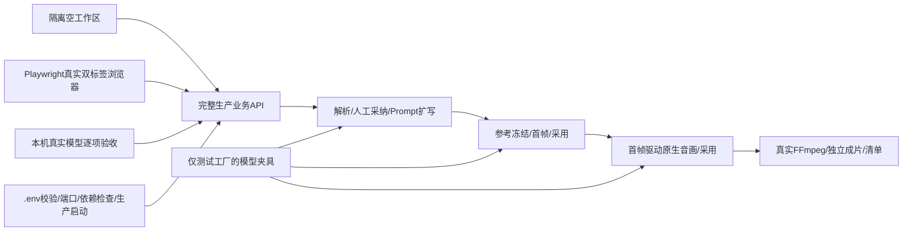
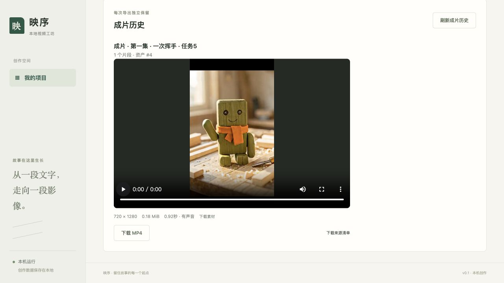

# 首版整体验收记录（M8）

日期：2026-10-26。M1～M7均已获用户验收；本轮任务12/M8，实现、独立累计审查修正和回归已完成；用户于2026-10-26明确确认“M8验收通过，合并PR #9”。

## 本轮方案与文件

新增`backend/tests/test_workflow_e2e.py`、共享模型夹具与仅测试使用的ASGI工厂；新增`frontend/tests/e2e/workflow.spec.ts`及Playwright配置；新增`scripts/start-local.sh`及Python运行辅助与测试；新增`docs/本机运行与备份.md`。完善README、环境示例与API类型导出校验；仅修整体验收中确认的缺陷。

## 可行性检查

自动闭环仅替换外部推理，数据库、任务引擎、文件冻结、采用、媒体核验和FFmpeg保持真实。浏览器服务器每轮使用独立临时数据目录，不复用占用端口的服务；测试工厂不注册到生产入口。所有测试命令≤540秒，真实模型每次只执行一个任务。

启动入口解析dotenv数据，不执行.env为shell；只检查Python/Node/FFmpeg及配置/端口，不检测内存、不管理模型。后端与前端以生产方式运行，停止只处理本次拥有的进程。SQLite与媒体含绝对路径，文档明确停机整目录备份及原路径恢复，防止不完整复制或错误搬迁。

最终审查和交付PR针对最新main的累计产品分支，前序模块PR保留为历史。没有自动合并、发布或迁移正式数据。

## 验收结果

| 项目 | 证据及结果 |
|---|---|
| 后端完整回归 | 229 passed，21.43秒；真实FFmpeg、SQLite、文件发布、进程恢复均参与 |
| 前端组件 | 59 passed，9个文件；类型strict、ESLint、Prettier通过 |
| 真实浏览器 | Playwright Chromium，5 passed，31.8秒；完整UI制作与播放/下载、双标签202/429、导航保留草稿、断线及403同意图重试、旧响应隔离 |
| 生产构建 | Next.js生产构建成功；启动脚本--check、--build及已有构建启动均通过 |
| 端口与停止 | 第二实例拒绝，不影响首实例；只停止本次前后端；TIME_WAIT立即重启误报已用失败用例复现并修正 |
| 契约一致性 | export-openapi --check只读检测漂移，前端类型已同步；导出不初始化数据库 |
| 停机备份与恢复 | 隔离工作区39个原文件逐一SHA核对；SQLite integrity_check=ok、foreign_key_check为空；保留原件，在原绝对路径恢复并重启；5任务、资产采用、成片Range和IDLE状态均通过 |
| 正式数据 | 整轮仅用临时或.superpowers下独立验收数据，正式data/未创建；未导入旧项目数据 |

验收服务及临时标签页已关闭，正式data/未创建，三个用户模型服务仍在监听。上述每次测试均通过run-check限定总截止≤540秒。自动推理夹具与真实模型分开：夹具只替代本机推理，业务API/BackgroundTasks/文件/FFmpeg均真实；浏览器会拦截意外非本机请求，后端闭环禁止出站socket连接。

## 真实模型完整闭环

从新空库建立原创“小木的问候”项目与一镜剧本；参考复用本平台此前自绘的木制机器人图，不导入旧DrawThings记录。逐项真实调用并明确采纳/采用，未开放自动整集生成。

| 任务 | 真实输入/结果 | 执行耗时 |
|---|---|---|
| #1 解析 | Qwen将已保存剧本拆为一镜，角色robot、无对白、声音要求保留；草稿采纳后DRAFT | 5.11秒 |
| #2 扩写 | Qwen产生image/video/audio三类Prompt；人工确认后采纳，绑定人物参考 | 6.67秒 |
| #3 首帧 | Klein 9B，256×384、4步、seed42，冻结参考实际进入gRPC；资产#2明确采用 | 3.37秒 |
| #4 音画 | H3 fast4步、256×384、目标1秒→22帧/24fps；冻结首帧Base64驱动，原生PCM保留；资产#3明确采用 | 19.83秒 |
| #5 成片 | 竖屏720×1280、H.264、AAC48kHz双声道，完整解码成功；下载SHA及来源清单一致 | 0.70秒 |

[原创成片](media/m8-original-film.mp4)、[来源清单](media/m8-original-film.manifest.json)。实际时长0.916667秒，音轨RMS882.40、峰值27210（s16le单声道解码核验），非静音；SHA256为`ea78371ddc2fc3ac1b0ab10171fc7deb1a1aadd9e1177f83fb66be72b7463fb4`。真实浏览器已播放并确认画面从手臂放下到挥手，下载入口正常。自动播放测试为静音进度检查，不冒充人工试听结论。

## 已验证版本

| 类别 | 版本/模型 |
|---|---|
| Python / SQLite | 3.13.14 / 3.53.1 |
| Node / Next / React / TypeScript | 24.17.0 / 16.4.3 / 19.3.1 / 5.9.3 |
| FastAPI / SQLAlchemy / Uvicorn | 0.162.0 / 2.0.55 / 0.54.0 |
| Draw Things SDK / HTTPX2 / Pillow | 0.4.0 / 2.16.0 / 12.3.0 |
| FFmpeg / ffprobe | 9.0.2 / 9.0.2，libx264/AAC/reset_sar |
| Playwright / Chromium | 1.64.1 / 156.0.8078.4（revision1248） |
| 本机LLM | qwen3.8-27b-mlx@8bit，OpenAI兼容端口1234 |
| Draw Things模型 | flux_2_klein_9b_kv_i8x.ckpt，gRPC7859/TLS |
| H3模型 | ddalcu/MiniMax-H3-FL2VA-MLX-Serve-8bit，MLX-Serve11234 |

Python/Node依赖分别以uv.lock、package-lock.json为复现依据；上表模型ID为服务端返回值，不保证所有同名权重或未来服务版本协议相同。Draw Things及MLX-Serve应用未提供可核验的发行版本，记录实际协议和模型ID，不猜测版本号。

## 剩余边界

- 单机单用户、同一数据目录只一个后端；所有耗时任务共用占位，无排队、无人值守整集生成或跨进程任务续跑。
- BackgroundTasks进程退出后不承诺任务继续；远程执行不确定时保持NEEDS_RESET，须用户确认上游停止后恢复。
- 首版备份恢复只支持原绝对路径；不迁移旧数据，不提供跨路径重写、物理清理、多用户、云同步。
- 本轮真实音画是1秒短样；较长片段和高分辨率的耗时、视觉连续性、对白准确度与口型仍须逐片人工验收。多片混排音画对齐由M7三段原创验收及完整回归覆盖。
- 不检测内存、不管理用户模型进程；模型文件和本机服务由用户独立准备。本版无字幕编辑、转场、多轨、独立TTS或声音克隆。

## 累计审查与交付

前序模块PR尚未合并，本轮最终PR以最新main为base、包含完整产品累计差异；前序PR作为模块历史保留，不自动合并。累计审查范围`2fe9163..a7006cf`，由独立新上下文审查者分批阅读完整生产后端、客户端协议、迁移、前端页面/组件和启动链路，并核对五类重点故障。无Critical，确认1项Important及1项Minor。

Important：采用首帧的旧成功响应晚于分镜文字保存响应时，ShotList单镜写入回调无条件替换DTO，使已保存文字回退显示且后续使用旧版本。新增“旧采用成功响应晚到，不得回退已保存文字和已清除草稿”测试先复现失败，再让单镜回调复用已有列表的Shot.version/Selection.version单调合并；同时检查采用保持和下一次保存版本。修复不改变API、数据库或模型协议。按一次修复轮执行完整回归，不用第二次审查替代测试证据。修复后后端229/229、前端59/59、真实浏览器5/5、strict类型、ESLint、Prettier、生产构建及契约检查全部通过；无剩余已确认的Critical/Important。

轻微遗留：项目页仍显示“剧本解析、素材与分镜制作会在后续模块开放”的旧提示。实际能力已开放，操作入口和制作功能正常；按Minor记录延后文案修正。交付分支`codex/m8-release-validation`，实现提交`a7006cf`，审查修复提交`2439414`；[交付PR #9](https://github.com/yyl1212/video_maker/pull/9)已创建并关联本任务，base为最新main `2fe9163`，无本地冲突。前序模块PR保留为历史；用户已授权合并交付PR #9，合并结果以PR状态为准，本次不发布。M8已获用户整体验收，当前已实现及验收12/12任务、14/14故事。

## 本轮裁定

1. 沿用可写原仓库独立功能分支并同步附加worktree：附加工作区沙箱限制已验证；代价为额外同步步骤。
2. M8最终审查与PR对准最新main的累计产品分支：前序堆叠PR仍未合并，整体验收需要完整交付视图；代价是审查与PR范围较大，前序PR作为模块历史保留，不自动合并。

3. 跨路径恢复和旧DrawThings数据迁移不纳入首版验收：用户明确空库起步且数据库保存绝对路径，已验证停机整目录原路径恢复；代价是搬迁到其他用户名/路径时需另行迁移工具。
4. 队列、模型取消及重启后自动续跑不纳入本轮：单任务BackgroundTasks首版明确忙时拒绝且不自动重放，未知执行须人工确认恢复；代价是中断后需人工收尾并重建任务，不支持无人值守续跑。
5. 自动模型下载、卸载和内存门禁不纳入本轮：用户明确排除内存检测和模型管理，由用户准备并独立运行服务；代价是环境和模型可用性需要人工保障。
6. 较长片段视觉连续性、对白准确度及自然度不以短样判定通过：M8实测短样证明协议和交付，文档要求逐片人工验收效果；代价是更长内容的艺术质量与耗时仍需实际验片。
